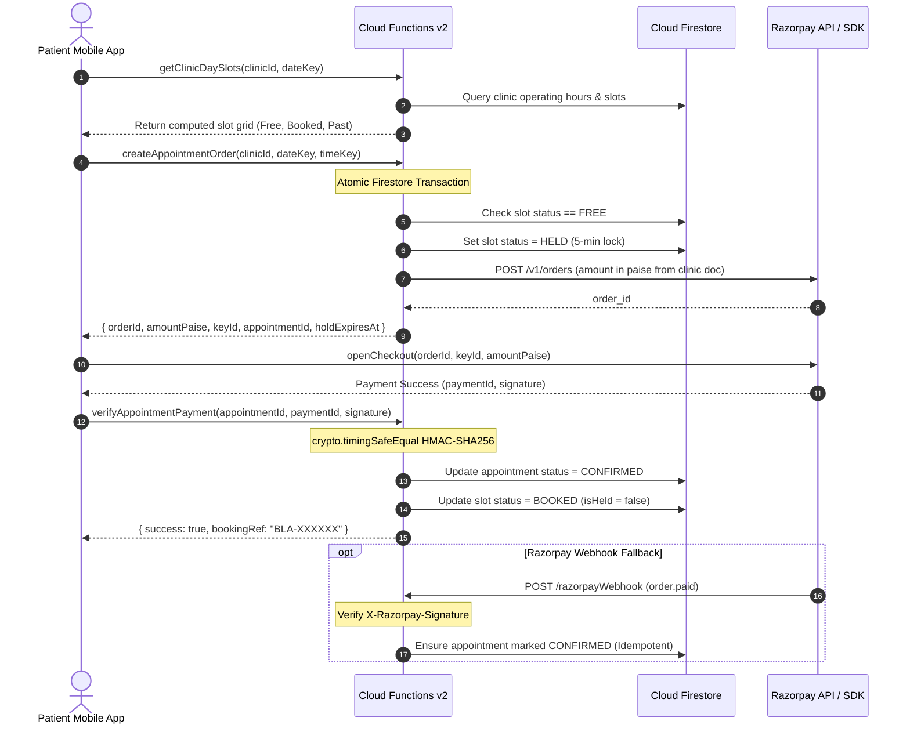

# 🏥 BedLink: Real-Time Emergency Healthcare, Bed Allocation & AI Diagnostics
## Comprehensive Technical Architecture & Engineering Report

---

## 📑 Table of Contents
1. [Executive Summary](#1-executive-summary)
2. [Problem Statement & Clinical Domain Context](#2-problem-statement--clinical-domain-context)
   - [2.1 The Emergency Room Dilemma: The "Golden Hour" Breakdown](#21-the-emergency-room-dilemma-the-golden-hour-breakdown)
   - [2.2 The Paramedic Fleet Onboarding & AIS-125 Compliance Challenge](#22-the-paramedic-fleet-onboarding--ais-125-compliance-challenge)
   - [2.3 The Outpatient Diagnostic & Healthcare Seeking Dilemma](#23-the-outpatient-diagnostic--healthcare-seeking-dilemma)
3. [The BedLink Integrated Solution Architecture](#3-the-bedlink-integrated-solution-architecture)
   - [3.1 Platform Architectural Topology](#31-platform-architectural-topology)
   - [3.2 Tri-Stakeholder Reactive Communication Model](#32-tri-stakeholder-reactive-communication-model)
4. [Comprehensive Feature-by-Feature Engineering Breakdown](#4-comprehensive-feature-by-feature-engineering-breakdown)
   - [Module 1: Ambulance Dispatch & Multi-Bed Needs Formulation](#module-1-ambulance-dispatch--multi-bed-needs-formulation)
   - [Module 2: Dynamic Hospital Bed Ranking Engine](#module-2-dynamic-hospital-bed-ranking-engine)
   - [Module 3: Synchronized 2-Minute Confirm-and-Hold & Auto-Cascading Engine](#module-3-synchronized-2-minute-confirm-and-hold--auto-cascading-engine)
   - [Module 4: Ambulance Fleet Onboarding, AIS-125 Compliance & Server Verification Engine](#module-4-ambulance-fleet-onboarding-ais-125-compliance--server-verification-engine)
   - [Module 5: Live GPS Ambulance Telemetry, Interactive Nurse Map & Drive Simulator](#module-5-live-gps-ambulance-telemetry-interactive-nurse-map--drive-simulator)
   - [Module 6: Hospital Nurse 10-Second Bed Inventory Dashboard](#module-6-hospital-nurse-10-second-bed-inventory-dashboard)
   - [Module 7: FCM Background Wake-Ups, Full-Screen Intent Alarm & Insistent Looping Siren](#module-7-fcm-background-wake-ups-full-screen-intent-alarm--insistent-looping-siren)
   - [Module 8: Hospital Nurse 4-Tab Portal & Salted SHA-256 PIN Security](#module-8-hospital-nurse-4-tab-portal--salted-sha-256-pin-security)
   - [Module 9: Multimodal AI Medical Test Report Analyzer](#module-9-multimodal-ai-medical-test-report-analyzer)
   - [Module 10: Specialty Clinic & Diagnostic Pathology Lab Discovery Engine](#module-10-specialty-clinic--diagnostic-pathology-lab-discovery-engine)
   - [Module 11: Specialty Clinic & Pathology Lab Appointment Booking, Razorpay Payments & Monetization Engine](#module-11-specialty-clinic--pathology-lab-appointment-booking-razorpay-payments--monetization-engine)
   - [Module 12: Hidden Hackathon Demonstration & Simulation Controls](#module-12-hidden-hackathon-demonstration--simulation-controls)
   - [Module 13: Patient Health Profile, Digital Vitals & Emergency Contacts](#module-13-patient-health-profile-digital-vitals--emergency-contacts)
   - [Module 14: Emergency Trip Completion & Final Bed Handshake](#module-14-emergency-trip-completion--final-bed-handshake)
   - [Module 15: Ambulance Crew Availability, Presence & Relief Foundation](#module-15-ambulance-crew-availability-presence--relief-foundation)
   - [Module 16: Disabled Emergency Relief Backend, Wave Engine & Dual Alert Stack](#module-16-disabled-emergency-relief-backend-wave-engine--dual-alert-stack)
   - [Module 17: Crew Voice Note Attachment & Nurse Audio Player](#module-17-crew-voice-note-attachment--nurse-audio-player)
5. [Mathematical Formulations & Algorithmic Models](#5-mathematical-formulations--algorithmic-models)
   - [5.1 Hospital Bed Allocation Ranking Score Formulation ($S_h$)](#51-hospital-bed-allocation-ranking-score-formulation-s_h)
   - [5.2 Distance & Route Estimation Equations](#52-distance--route-estimation-equations)
   - [5.3 Vehicle Heading & Forward Azimuth Bearing Equation](#53-vehicle-heading--forward-azimuth-bearing-equation)
   - [5.4 Real-Time Coordinate Interpolation Model](#54-real-time-coordinate-interpolation-model)
   - [5.5 Hospital Reachability & 0-Second Skip Determination](#55-hospital-reachability--0-second-skip-determination)
   - [5.6 Fuzzy String Matching Metric (Levenshtein Distance)](#56-fuzzy-string-matching-metric-levenshtein-distance)
   - [5.7 Relief Candidate Selection Algorithm](#57-relief-candidate-selection-algorithm)
   - [5.8 Wave Expansion Radius Model](#58-wave-expansion-radius-model)
6. [Database Architecture & Cloud Firestore Schema Definitions](#6-database-architecture--cloud-firestore-schema-definitions)
   - [6.1 Hospital Profile Collection (`hospitals/{hospitalId}`)](#61-hospital-profile-collection-hospitalshospitalid)
   - [6.2 Device Registry Sub-Collections (`devices/{deviceId}`)](#62-device-registry-sub-collections-devicesdeviceid)
   - [6.3 Emergency Requests Collection (`requests/{requestId}`)](#63-emergency-requests-collection-requestsrequestid)
   - [6.4 High-Frequency Telemetry Collection (`liveLocations/{requestId}`)](#64-high-frequency-telemetry-collection-livelocationsrequestid)
   - [6.5 Ambulance Fleet Registry (`ambulances/{uid}`)](#65-ambulance-fleet-registry-ambulancesuid)
   - [6.6 Specialty Clinics & Pathology Labs (`clinics/{clinicId}`)](#66-specialty-clinics--pathology-labs-clinicsclinicid)
   - [6.7 Real-Time Slot Inventory (`slots/{slotDocId}`)](#67-real-time-slot-inventory-slotsslotdocid)
   - [6.8 Patient Confirmed Appointments (`appointments/{appointmentId}`)](#68-patient-confirmed-appointments-appointmentsappointmentid)
   - [6.9 Firebase Cloud Storage Hierarchy (`storage.rules`)](#69-firebase-cloud-storage-hierarchy-storagerules)
   - [6.10 Crew Presence Telemetry (`crewPresence/{uid}`)](#610-crew-presence-telemetry-crewpresenceuid)
   - [6.11 Disabled Emergency Relief Requests (`reliefRequests/{id}`)](#611-disabled-emergency-relief-requests-reliefrequestsid)
   - [6.12 Relief Offer Sub-Collection (`reliefRequests/{id}/offers/{candidateUid}`)](#612-relief-offer-sub-collection-reliefrequestsidofferscandidateuid)
7. [Security Invariants, Role Isolation & Compliance Architecture](#7-security-invariants-role-isolation--compliance-architecture)
   - [7.1 Server-Side Credential Immutability](#71-server-side-credential-immutability)
   - [7.2 Device Token Isolation & Zero Harvesting](#72-device-token-isolation--zero-harvesting)
   - [7.3 Hospital Nurse Terminal Isolation](#73-hospital-nurse-terminal-isolation)
   - [7.4 Unverified Crew Emergency Blockade](#74-unverified-crew-emergency-blockade)
   - [7.5 Live GPS Telemetry Authorization Invariants](#75-live-gps-telemetry-authorization-invariants)
   - [7.6 Zero PII Logging & Data Redaction Policy](#76-zero-pii-logging--data-redaction-policy)
   - [7.7 Slot & Appointment Server-Only Immutability](#77-slot--appointment-server-only-immutability)
   - [7.8 Relief Request & Offer Client-Write Blockade](#78-relief-request--offer-client-write-blockade)
   - [7.9 Voice Note Storage Access Control](#79-voice-note-storage-access-control)
8. [UI/UX Design System & Clinical Aesthetics](#8-uiux-design-system--clinical-aesthetics)
   - [8.1 Clinical Color Palette](#81-clinical-color-palette)
   - [8.2 Strict Semantic Red Rule](#82-strict-semantic-red-rule)
   - [8.3 Ergonomic Haptics & Cognitive Workload Management](#83-ergonomic-haptics--cognitive-workload-management)
9. [Complete Technology Stack & Native Build Engineering](#9-complete-technology-stack--native-build-engineering)
   - [9.1 Core Technology Matrix](#91-core-technology-matrix)
   - [9.2 Android 14 API 34 Native Desugaring & Permission Setup](#92-android-14-api-34-native-desugaring--permission-setup)
10. [Edge Cases, Resiliency Engineering & Failure Recovery Matrix](#10-edge-cases-resiliency-engineering--failure-recovery-matrix)
11. [Setup, Execution & Two-Phone Demonstration Guide](#11-setup-execution--two-phone-demonstration-guide)
    - [11.1 Prerequisites](#111-prerequisites)
    - [11.2 Flutter Mobile Setup & Physical Device Run](#112-flutter-mobile-setup--physical-device-run)
    - [11.3 Cloud Functions & Verification Engine Deployment](#113-cloud-functions--verification-engine-deployment)
    - [11.4 End-to-End Two-Phone Demonstration Script](#114-end-to-end-two-phone-demonstration-script)
12. [Automated Verification & Quality Assurance Results](#12-automated-verification--quality-assurance-results)
13. [Completed Engineering Phases & Active Roadmap](#13-completed-engineering-phases--active-roadmap)

---

## 1. Executive Summary

**BedLink** is an end-to-end mission-critical healthtech ecosystem engineered to eliminate emergency medicine's deadliest operational bottleneck: **the time-critical delay in locating, verifying, holding, and navigating to specialized hospital beds for acute patients**.

In high-acuity medical emergencies—including acute myocardial infarction, polytrauma, severe respiratory arrest, hemorrhagic shock, sepsis, and major burns—patient survival is governed by the **"Golden Hour"**. Every minute spent in transit or idling outside an emergency department drastically compounds mortality. Yet, modern urban emergency medicine remains burdened by fragmented communication: paramedics frantically telephone hospital desks or blindly transport unstable patients to emergency rooms without knowing if an Intensive Care Unit (ICU), neonatal ventilator, or burns unit is actually available.

BedLink completely reimagines emergency healthcare logistics through an integrated, reactive platform connecting three key stakeholders:
1. **Ambulance Dispatch Crews & Paramedics**: Providing multi-bed matching, dynamic multi-factor hospital ranking, an automated **2-Minute Confirm-and-Hold** protocol with zero-latency cascading, and real-time GPS telemetry tracking with road geometry visualization.
2. **Hospital Nursing & Bed-Management Staff**: Providing an ultra-responsive **10-Second Bed Update Dashboard** that operates seamlessly on entry-level mobile hardware, high-importance **FCM background wake-ups** with lockscreen full-screen intents and looping siren audio alerts, and atomic one-tap reservation acceptance.
3. **Patients & Outpatient Healthcare Seekers**: Providing a comprehensive **Healthcare Hub** that delivers multimodal **AI Medical Test Report Analysis** (translating complex lab values into plain English with triage recommendations), specialist clinic and pathology diagnostic lab discovery, and verified tele-consultations powered by digital payments.

---

## 2. Problem Statement & Clinical Domain Context

### 2.1 The Emergency Room Dilemma: The "Golden Hour" Breakdown
In Emergency Medical Services (EMS), system failures typically manifest across five structural choke points:
- **Blind Transports**: Paramedics transport unstable patients toward the geographically closest hospital under the blind assumption that necessary critical care facilities exist.
- **The "Beds Exist, But Where?" Modality Paradox**: A metropolitan hospital may report 30 vacant general beds while its 6 ICU beds and 2 mechanical ventilators are fully occupied. Transporting an intubated patient to such a facility forces a catastrophic secondary inter-hospital transfer.
- **Data Decay (The Staleness Trap)**: Bed availability fluctuates rapidly as patients are discharged, transferred, or succumb to illness. Centralized municipal dashboards updated every 12 to 24 hours provide dangerously misleading information.
- **The Handshake Void**: Even when a paramedic confirms a vacant bed via telephone, there is no reservation guarantee. During the 20 to 30 minutes the ambulance spends navigating city traffic, the bed is routinely reassigned to an internal walk-in emergency.
- **Cognitive Exhaustion in Nursing**: Emergency nurses manage severe clinical workloads. Cumbersome desktop Hospital Information Systems (HIS) with nested menus lead staff to abandon live inventory logging altogether.

### 2.2 The Paramedic Fleet Onboarding & AIS-125 Compliance Challenge
Emergency medical transit in India is governed by the **AIS-125 (Automotive Industry Standard 125)** standard, which categorizes ambulances into specific tiers:
- **Type A**: First Responder (emergency response vehicle without patient transport stretcher).
- **Type B**: Patient Transport Ambulance (basic stretcher transport without life support).
- **Type C**: Basic Life Support / Mobile Intensive Care Unit (BLS/MICU with cardiac monitors, oxygen, suction).
- **Type D**: Advanced Life Support (ALS with ventilators, defibrillators, infusion pumps).

Despite these standards:
- Private fleet operators frequently misrepresent commercial transport vehicles (such as retrofitted delivery vans or passenger cabs) as certified Mobile ICUs.
- Drivers frequently operate emergency vehicles without the mandatory commercial transport endorsement on their Parivahan Sarathi driving licenses.
- Unverified ambulances dispatching critical emergencies pose severe patient safety and liability risks.

### 2.3 The Outpatient Diagnostic & Healthcare Seeking Dilemma
Outside emergency ambulances, ambulatory healthcare seekers struggle with:
- **Medical Report Incomprehensibility**: Diagnostic reports (CBC, Thyroid Profiles, ECGs, Biopsies) are packed with clinical terminology and numeric reference ranges that create anxiety or lead patients to ignore life-threatening markers (e.g., elevated Troponin I or critical hypoxia).
- **Misallocated Healthcare Utilization**: Patients with minor, localized ailments (such as mild dermatitis or routine iron deficiency) frequently overwhelm hospital emergency rooms, while patients with emergent pathologies delay seeking critical care.
- **Fragmented Clinic Discovery**: Patients needing routine pathology or specialist consultations struggle to locate nearby clinics with transparent pricing, verified ratings, and operating hours.

---

## 3. The BedLink Integrated Solution Architecture

### 3.1 Platform Architectural Topology

BedLink solves these structural failures through a unified, reactive architecture built on **Flutter**, **Firebase Cloud Firestore**, **Firebase Cloud Functions (v2 TypeScript)**, **Firebase Cloud Messaging (FCM)**, **OpenRouter Multimodal AI (Google Gemini 2.5 Flash Lite)**, **Open Source Routing Machine (OSRM)**, and **Razorpay**:

```
┌─────────────────────────────────────────────────────────────────────────────────────────────────────────┐
│                                            BEDLINK PLATFORM                                             │
└───────────────────┬───────────────────────────────────┬───────────────────────────────────┬─────────────┘
                    │                                   │                                   │
                    ▼                                   ▼                                   ▼
       ┌─────────────────────────┐         ┌─────────────────────────┐         ┌─────────────────────────┐
       │   AMBULANCE DISPATCH    │         │     HOSPITAL NURSE      │         │   PATIENT HEALTH HUB    │
       │  - AIS-125 Registration │         │  - 10-Second Bed Tiles  │         │  - AI Report Analyzer   │
       │  - Multi-Bed Match Form │         │  - 1-Tap Freshness Touch│         │  - Clinic/Lab Discovery │
       │  - Multi-Factor Rank    │         │  - 4-Tab Portal Shell   │         │  - Tele-Consultations   │
       │  - 2-Min Hold Stepper   │         │  - FCM Lockscreen Siren │         │  - Digital Vitals Card  │
       │  - Auto-Cascade Failover│         │  - Atomic Accept/Reject │         │  - Razorpay Checkout    │
       │  - Live GPS Telemetry   │         │  - Live Tracking Map    │         │  - Emergency SOS Trigger│
       └────────────┬────────────┘         └────────────┬────────────┘         └────────────┬────────────┘
                    │                                   │                                   │
                    └─────────────────────────┬─────────┴───────────────────────────────────┘
                                              │ Real-Time Streams, Security Rules & Atomic Transactions
                                              ▼
                               ┌─────────────────────────────┐
                               │     FIREBASE FIRESTORE      │
                               │  - hospitals/{id}           │
                               │  - requests/{id}            │
                               │  - ambulances/{uid}         │
                               │  - liveLocations/{id}       │
                               │  - clinics/{id}             │
                               └──────────────┬──────────────┘
                                              │
                    ┌─────────────────────────┼─────────────────────────┐
                    ▼                         ▼                         ▼
       ┌────────────────────────┐┌────────────────────────┐┌────────────────────────┐
       │  CLOUD FUNCTIONS (V2)  ││   OSRM ROUTING API     ││    EXTERNAL APIS       │
       │ - AIS-125 Verification ││ - Turn-by-Turn Driving ││ - OpenRouter AI Vision │
       │ - Multicast FCM Alerts ││ - Distance & Duration  ││ - Razorpay Payment REST│
       │ - Token Pruning & ACKs ││ - Route Geometry Poly  ││ - Parivahan Vahan/Sarathi│
       └────────────────────────┘└────────────────────────┘└────────────────────────┘
```

### 3.2 Tri-Stakeholder Reactive Communication Model
1. **The Paramedic Dispatch Loop**:
   - The crew inputs patient acuity and bed requirements.
   - The client invokes OSRM / Haversine engines to rank metropolitan hospitals based on driving time, freshness, and capacity.
   - The crew triggers an automated 120-second confirm-and-hold request targeting the top-ranked facility.
2. **The Cloud Coordination Loop**:
   - Firestore emits document writes triggering Cloud Functions v2 (`onEmergencyRequestWrite`).
   - High-priority FCM data messages wake up nurse station devices even when locked or terminated.
   - Hospital presence heartbeats and device token registries continuously compute facility reachability.
3. **The Hospital Bed Management Loop**:
   - Nurse stations display insistent looping sirens with patient clinical notes.
   - Nurses execute atomic one-tap acceptance (`holdBedTransaction`), locking the bed reservation.
   - Once accepted, live GPS telemetry streams the ambulance's approach directly to the nurse's interactive map until final admission arrival.

---

## 4. Comprehensive Feature-by-Feature Engineering Breakdown

### Module 1: Ambulance Dispatch & Multi-Bed Needs Formulation
- **File Implementation**: [`lib/features/dispatch/new_request_screen.dart`](file:///Users/harsh_thakur/Desktop/Bedlink/lib/features/dispatch/new_request_screen.dart), [`lib/providers/request_providers.dart`](file:///Users/harsh_thakur/Desktop/Bedlink/lib/providers/request_providers.dart), [`lib/models/emergency_request.dart`](file:///Users/harsh_thakur/Desktop/Bedlink/lib/models/emergency_request.dart)
- **Features & Capabilities**:
  - **Multi-Modal Bed Needs Selection**: Multi-select toggle chips allowing simultaneous demand for combinations of **ICU**, **Ventilator**, **Oxygen**, **Cardiac**, **Burns**, and **General** beds.
  - **Clinical Acuity Triaging**: 3-level patient severity selector (🔴 **Critical** with 1.5× travel weight, 🟡 **Serious** with 1.0× baseline weight, 🟢 **Stable** with 0.8× travel weight).
  - **Clinical Field Observations**: Free-text clinical notes field enabling paramedics to document acute trauma, vitals, and intubation status.
  - **GPS Telemetry Origin with Map Pin Override**: Automatically retrieves location coordinates via device GPS; includes an interactive Leaflet/OpenStreetMap modal dialog allowing paramedics to manually position an origin pin anywhere in the metropolitan area.
  - **Pre-Flight Verified Ambulance Guard**: Automatically injects the authenticated crew's verified vehicle snapshot (`AmbulanceSnapshot`) into the request document.
  - **Dual Mode Adaptability**: Supports both Paramedic Crew mode (with verified vehicle credentials) and Patient Direct emergency bed search mode (unauthenticated rapid search).

### Module 2: Dynamic Hospital Bed Ranking Engine
- **File Implementation**: [`lib/services/ranking_service.dart`](file:///Users/harsh_thakur/Desktop/Bedlink/lib/services/ranking_service.dart), [`lib/features/dispatch/results_screen.dart`](file:///Users/harsh_thakur/Desktop/Bedlink/lib/features/dispatch/results_screen.dart), [`lib/models/hospital_rank_result.dart`](file:///Users/harsh_thakur/Desktop/Bedlink/lib/models/hospital_rank_result.dart)
- **Features & Capabilities**:
  - **Multi-Factor Scoring Matrix**: Evaluates all hospitals against street driving duration, data freshness age, emergency room operational load, and modality match depth.
  - **OSRM Driving Calculation**: Asynchronously queries the Open Source Routing Machine HTTP API (`router.project-osrm.org`) for exact driving time and kilometers.
  - **Haversine Distance Engine Fallback**: If OSRM times out after 3 seconds or fails, automatically computes great-circle distance scaled by urban transit velocity ($25\text{ km/h}$).
  - **"Why this rank?" Transparency Modal**: Every hospital card features an information sheet revealing the exact mathematical formula components:
    $$\text{Final Score} = \text{Travel Score} + \text{Staleness Penalty} + \text{Load Penalty} + \text{Partial Match Penalty}$$
  - **Reachable vs. Unreachable Status Badge**: Displays real-time status chips indicating whether the hospital is `"Nurse Online"`, `"Reachable via Push"`, or `"Unreachable"`.
  - **Stale Data Filter**: A toggle button allowing dispatchers to hide any facility whose inventory has not been updated within 60 minutes.

### Module 3: Synchronized 2-Minute Confirm-and-Hold & Auto-Cascading Engine
- **File Implementation**: [`lib/features/dispatch/hold_status_screen.dart`](file:///Users/harsh_thakur/Desktop/Bedlink/lib/features/dispatch/hold_status_screen.dart), [`lib/services/firestore_service.dart`](file:///Users/harsh_thakur/Desktop/Bedlink/lib/services/firestore_service.dart), [`lib/core/widgets/countdown_ring.dart`](file:///Users/harsh_thakur/Desktop/Bedlink/lib/core/widgets/countdown_ring.dart)
- **Features & Capabilities**:
  - **Synchronized 120-Second Countdown**: Built with [`CountdownRing`](file:///Users/harsh_thakur/Desktop/Bedlink/lib/core/widgets/countdown_ring.dart). Both ambulance crew and nurse station terminals count down synchronously from an authoritative Firestore server timestamp (`offerExpiresAt`).
  - **Automated Cascade Failover**: If the active hospital rejects the offer or fails to respond within 120 seconds, the system logs the attempt, shifts `currentIndex` to $N+1$, and issues a new 120-second offer to the next ranked hospital.
  - **Zero-Second Auto-Skip**: If the target hospital has 0 available beds or is flagged completely unreachable (`!targetHospital.isReachable`), BedLink triggers an immediate auto-skip (0 seconds elapsed), bypassing the dead hospital to save critical patient time.
  - **Delivery Acknowledgment (ACK) Visual**: Displays an `"Alert delivered to hospital"` teal chip under the countdown ring the moment the hospital terminal receives the push alert.
  - **Atomic Transaction Hold**: When accepted, a Firestore transaction validates capacity, decrements the inventory, and sets request status to `accepted`.

### Module 4: Ambulance Fleet Onboarding, AIS-125 Compliance & Server Verification Engine
- **File Implementation**: [`lib/features/crew/`](file:///Users/harsh_thakur/Desktop/Bedlink/lib/features/crew/), [`functions/src/services/verificationEngine.ts`](file:///Users/harsh_thakur/Desktop/Bedlink/functions/src/services/verificationEngine.ts), [`functions/src/rules/`](file:///Users/harsh_thakur/Desktop/Bedlink/functions/src/rules/), [`functions/src/providers/`](file:///Users/harsh_thakur/Desktop/Bedlink/functions/src/providers/), [`functions/src/index.ts`](file:///Users/harsh_thakur/Desktop/Bedlink/functions/src/index.ts)
- **Features & Capabilities**:
  - **3-Step Guided Registration**:
    - *Step 1 (Vehicle)*: Vehicle Registration Number, AIS-125 Tier (`Type A/B/C/D`), Operator Fleet Type (`GOVERNMENT` vs `PRIVATE`), and RC document upload.
    - *Step 2 (Driver)*: Driver Legal Full Name, DL Number, Date of Birth, 10-digit mobile number, and DL document upload.
    - *Step 3 (Submission)*: Direct submission to Cloud Functions.
  - **Automated Cloud Verification Engine**:
    - *Parivahan Vahan Engine*: Validates RC status (`ACTIVE`), certifies vehicle class (`AMBULANCE`), and verifies vehicle fitness expiration.
    - *Sarathi Driving License Engine*: Verifies license status (`ACTIVE`), expiration, and enforces the mandatory commercial transport endorsement.
    - *Fuzzy Levenshtein Name Match*: Matches driver names against RC ownership records, tolerating honorifics and initials, while flagging institutional fleets (`HOSPITAL`, `TRUST`) for desk review (`NEEDS_REVIEW`).
  - **Ambulance ID Badge Allocation**: Verified crews receive a permanent badge (e.g., `BL-AMB-100001`) and synthetic credentials (`app-xxxxxx@crew.bedlink.app`).
  - **Dual Identifier Login**: Crews can sign in using either their Application Reference (`APP-XXXXXX`) or official Ambulance ID (`BL-AMB-XXXXXX`).
  - **Server-Side Immutability**: Critical fields (`ambulanceId`, `vehicleNumber`, `verificationStatus`) can only be modified by Cloud Functions (Admin SDK); client attempts to alter them are rejected by Firestore security rules.

### Module 5: Live GPS Ambulance Telemetry, Interactive Nurse Map & Drive Simulator
- **File Implementation**: [`lib/services/live_location_service.dart`](file:///Users/harsh_thakur/Desktop/Bedlink/lib/services/live_location_service.dart), [`lib/features/nurse/widgets/live_ambulance_map_card.dart`](file:///Users/harsh_thakur/Desktop/Bedlink/lib/features/nurse/widgets/live_ambulance_map_card.dart), [`lib/services/routing_service.dart`](file:///Users/harsh_thakur/Desktop/Bedlink/lib/services/routing_service.dart)
- **Features & Capabilities**:
  - **Telemetry Streaming Pipeline**: High-frequency vehicle location streaming via `geolocator` pushing to isolated collection `liveLocations/{requestId}`.
  - **Throttling & Jitter Suppression**: Minimum 4-second write interval when moving; locations with accuracy $>100\text{m}$ skipped. At stoplights ($\text{speed} < 2\text{ km/h}$), the last valid heading is preserved to prevent compass jitter.
  - **15-Second Stationary Heartbeat**: Keeps signal alive during dense traffic jams. Write volume is strictly capped at $\le 15\text{ writes/min}$.
  - **Interactive OpenStreetMap Card**: Built with `flutter_map` (zero billing/API keys). Features dynamic vehicle marker rotation matching real-time heading, smooth 1.2-second coordinate interpolation, and turn-by-turn OSRM route polyline rendering with dashed straight-line fallback.
  - **Clinical Freshness States**:
    - 🟢 **Live** ($< 20\text{s}$): Pulsing green dot.
    - 🟡 **Delayed** ($20\text{s} - 60\text{s}$): Amber badge with seconds counter.
    - ⚪ **Signal Lost** ($> 60\text{s}$): Grey badge with last seen timestamp (adhering to semantic-red safety rules).
  - **Arrival Proximity Detection**: Automatically displays an `"Arriving now"` teal chip when the ambulance reaches within 150 meters of the hospital gates.
  - **Embedded Route Simulator (Debug Mode)**: Allows testing live tracking with 1x, 2x, or 4x speed multipliers driving along the actual OSRM road geometry.

### Module 6: Hospital Nurse 10-Second Bed Inventory Dashboard
- **File Implementation**: [`lib/features/nurse/bed_update_screen.dart`](file:///Users/harsh_thakur/Desktop/Bedlink/lib/features/nurse/bed_update_screen.dart), [`lib/core/widgets/bed_tile.dart`](file:///Users/harsh_thakur/Desktop/Bedlink/lib/core/widgets/bed_tile.dart)
- **Features & Capabilities**:
  - **Tactile Bed Tiles ([`BedTile`](file:///Users/harsh_thakur/Desktop/Bedlink/lib/core/widgets/bed_tile.dart))**: Dedicated cards for **ICU**, **Ventilator**, **Oxygen**, **Cardiac**, **Burns**, and **General**.
  - **1-Tap Increment & Decrement**: Large `+` and `−` buttons with active haptic feedback.
  - **1-Tap Available / Full Toggle**: Tapping the card body immediately drops capacity to zero or restores previous capacity.
  - **Dynamic Status Visuals**: Green for available ($>2$ beds), Amber for low ($1-2$ beds), and Red for full ($0$ beds).
  - **"✓ Everything is up to date" Button**: A sticky 1-second touch action updating `lastUpdated: FieldValue.serverTimestamp()` without modifying counts.
  - **Emergency Room Load Level Selector**: Quick-select chips (Low, Medium, High) to broadcast operational strain.

### Module 7: FCM Background Wake-Ups, Full-Screen Intent Alarm & Insistent Looping Siren
- **File Implementation**: [`lib/services/fcm_service.dart`](file:///Users/harsh_thakur/Desktop/Bedlink/lib/services/fcm_service.dart), [`lib/services/alarm_notification_service.dart`](file:///Users/harsh_thakur/Desktop/Bedlink/lib/services/alarm_notification_service.dart), [`functions/src/services/fcmAlertService.ts`](file:///Users/harsh_thakur/Desktop/Bedlink/functions/src/services/fcmAlertService.ts)
- **Features & Capabilities**:
  - **Top-Level Background Handler**: `@pragma('vm:entry-point')` function executing autonomously when the app is backgrounded or **TERMINATED**.
  - **Cloud Function Alert Trigger**: Firestore trigger `onEmergencyRequestWrite` automatically dispatches high-priority data-only pushes (`type: "incoming_request"`, TTL $\le 120$s) to all active nurse devices when an offer is initiated or cascaded.
  - **High-Importance Alarm Notification Channel**: Channel `bedlink_emergency_alerts` configured with `Importance.max`, `Priority.max`, alarm audio usage, and raw siren sound (`android/app/src/main/res/raw/siren.mp3`).
  - **Lockscreen Full-Screen Intent**: Wakes locked devices (`showWhenLocked="true"`, `turnScreenOn="true"`), sounding an insistent looping siren (`FLAG_INSISTENT`).
  - **Android 14 Compatibility**: Fully integrates `requestFullScreenIntentPermission()` and Java 8 core library desugaring.
  - **3-State Tap Routing**: Cold-starts or resumes the app directly to the active triage screen; validates that the request is still `offered` to this hospital and unexpired. If resolved or expired, displays `"This request is no longer active"` and silences audio.
  - **Auto-Cancel Safety Net**: Local timer mapped to `offerExpiresAt` clears the notification if network drops prevent receiving a cancel push.
  - **Emergency Alerts Setup Screen**: Profile checklist showing live status for push notifications, full-screen intents, battery optimization exemptions, OEM autostart guidance, and a callable button triggering `sendTestFcmAlert`.

### Module 8: Hospital Nurse 4-Tab Portal & Salted SHA-256 PIN Security
- **File Implementation**: [`lib/features/nurse/nurse_shell_screen.dart`](file:///Users/harsh_thakur/Desktop/Bedlink/lib/features/nurse/nurse_shell_screen.dart), [`lib/features/nurse/nurse_home_screen.dart`](file:///Users/harsh_thakur/Desktop/Bedlink/lib/features/nurse/nurse_home_screen.dart), [`lib/features/nurse/bed_update_screen.dart`](file:///Users/harsh_thakur/Desktop/Bedlink/lib/features/nurse/bed_update_screen.dart), [`lib/features/nurse/request_history_screen.dart`](file:///Users/harsh_thakur/Desktop/Bedlink/lib/features/nurse/request_history_screen.dart), [`lib/features/nurse/hospital_profile_screen.dart`](file:///Users/harsh_thakur/Desktop/Bedlink/lib/features/nurse/hospital_profile_screen.dart), [`lib/features/nurse/widgets/ambulance_info_section.dart`](file:///Users/harsh_thakur/Desktop/Bedlink/lib/features/nurse/widgets/ambulance_info_section.dart), [`lib/features/nurse/widgets/request_detail_sheet.dart`](file:///Users/harsh_thakur/Desktop/Bedlink/lib/features/nurse/widgets/request_detail_sheet.dart)
- **Features & Capabilities**:
  - **Unified 4-Tab Navigation**:
    - *Tab 0 (Home)*: Station status, Quick Bed Glance metrics, active emergency sirens, and live inbound ambulance tracking.
    - *Tab 1 (Availability)*: 10-second tactile bed tiles and load level selectors.
    - *Tab 2 (Requests)*: Historical transaction logs with expandable detail sheets and cascade attempt histories.
    - *Tab 3 (Profile)*: Hospital metadata view, emergency alerts setup checklist, and PIN authentication.
  - **Cross-Tab Intrusion Siren Handshake**: Incoming emergency triage modals instantly override all 4 tabs, ensuring zero missed emergencies.
  - **Cryptographic Salted SHA-256 PIN Security**: Upgrades terminal security from plaintext PINs to salted SHA-256 password hashing (`pinHash` + `pinSalt`). Plaintext PINs are stripped before updating Firestore.

### Module 9: Multimodal AI Medical Test Report Analyzer
- **File Implementation**: [`lib/services/openrouter_service.dart`](file:///Users/harsh_thakur/Desktop/Bedlink/lib/services/openrouter_service.dart), [`lib/services/report_analysis_service.dart`](file:///Users/harsh_thakur/Desktop/Bedlink/lib/services/report_analysis_service.dart), [`lib/features/patient/report_analysis_screen.dart`](file:///Users/harsh_thakur/Desktop/Bedlink/lib/features/patient/report_analysis_screen.dart), [`lib/features/patient/report_list_screen.dart`](file:///Users/harsh_thakur/Desktop/Bedlink/lib/features/patient/report_list_screen.dart)
- **Features & Capabilities**:
  - **Multimodal Document Pipeline**: Ingests paper laboratory printouts and digital diagnostic reports via camera capture, gallery selection, or PDF upload.
  - **OpenRouter AI Intelligence**: Uses `google/gemini-2.5-flash-lite` to extract biomarkers and translate clinical jargon into plain, compassionate English.
  - **Structured JSON Schema**: Enforces machine-parseable outputs containing severity triage (`normal`, `attention`, `critical`), headline, simple explanation, bulleted key findings, and specialist recommendations.
  - **Autonomous Heuristic Fallback Engine**: If the AI API is offline or unkeyed, an internal regex heuristic engine analyzes biomarkers (detecting $\text{SPO2} < 90\%$, Troponin I, ST elevation, severe anemia, or thyroid imbalances) within milliseconds.
  - **Direct Triage Action Flow**: Critical findings render red banners with a direct button to *"Find Emergency Hospital Bed"*; non-critical findings link directly to *"Find Specialist Clinic"*.

### Module 10: Specialty Clinic & Diagnostic Pathology Lab Discovery Engine
- **File Implementation**: [`lib/features/patient/clinic_search_screen.dart`](file:///Users/harsh_thakur/Desktop/Bedlink/lib/features/patient/clinic_search_screen.dart), [`lib/services/clinic_ranking_service.dart`](file:///Users/harsh_thakur/Desktop/Bedlink/lib/services/clinic_ranking_service.dart), [`lib/features/patient/clinic_results_screen.dart`](file:///Users/harsh_thakur/Desktop/Bedlink/lib/features/patient/clinic_results_screen.dart), [`lib/models/clinic.dart`](file:///Users/harsh_thakur/Desktop/Bedlink/lib/models/clinic.dart)
- **Features & Capabilities**:
  - **Multi-Specialty Directory**: Filters across 10 clinical domains: Dermatology, Blood Tests & Pathology, Gynecology, Dental, Pediatrics, Orthopedics, Ophthalmology, X-Ray, MRI/CT, and Ultrasound.
  - **Tokenized Search & Matching**: Tokenizes patient queries and matches against clinical specialties and diagnostic test catalogs.
  - **Proximity & Quality Ranking**: Combines travel duration, verified clinic ratings, open/closed operating status, and specialty match depth.
  - **Direct Communication & Navigation**: Integrated `tel:` phone dialer and Google Maps navigation launch intents.

### Module 11: Specialty Clinic & Pathology Lab Appointment Booking, Razorpay Payments & Monetization Engine
- **File Implementation**:
  - [`lib/features/patient/appointment_booking_screen.dart`](file:///Users/harsh_thakur/Desktop/Bedlink/lib/features/patient/appointment_booking_screen.dart) (Interactive 7-day strip, IST slot grid, 5-min countdown timer, patient details form)
  - [`lib/features/patient/appointment_confirmation_screen.dart`](file:///Users/harsh_thakur/Desktop/Bedlink/lib/features/patient/appointment_confirmation_screen.dart) (BLA reference card, non-refundable policy, clinic contact & directions)
  - [`lib/features/patient/my_appointments_screen.dart`](file:///Users/harsh_thakur/Desktop/Bedlink/lib/features/patient/my_appointments_screen.dart) (Live Firestore stream of upcoming and past outpatient bookings)
  - [`lib/services/appointment_service.dart`](file:///Users/harsh_thakur/Desktop/Bedlink/lib/services/appointment_service.dart) (Client callable bindings & Razorpay delegate abstraction)
  - [`lib/core/constants/booking_constants.dart`](file:///Users/harsh_thakur/Desktop/Bedlink/lib/core/constants/booking_constants.dart) (Canonical fees, hold times, and clinical policies)
  - [`functions/src/services/appointmentService.ts`](file:///Users/harsh_thakur/Desktop/Bedlink/functions/src/services/appointmentService.ts) (Server slot scheduler, Razorpay order generation, HMAC verification, webhook handler, demo seeding & revenue aggregation)
  - [`functions/src/index.ts`](file:///Users/harsh_thakur/Desktop/Bedlink/functions/src/index.ts) (Cloud Functions v2 exports with CORS & secret manager bindings)
- **Problem Statement & Clinical Context**:
  While emergency bed allocation solves critical golden-hour emergencies, fragmented outpatient access represents 85% of urban healthcare demand. Clinics and pathology diagnostic labs struggle with unpredictable patient queues, 20-30% patient no-show rates, and manual payment reconciliations. Conversely, patients face indefinite waiting room delays and lack of guaranteed appointment reservations.
- **BedLink Architectural Solution**:
  BedLink implements a high-throughput, bank-grade appointment booking engine with cryptographic slot reservation, server-side price validation, synchronized 5-minute atomic holds, native Razorpay Checkout, and instant confirmation tracking:



- **Technical Invariants & Core Constants**:
  | Parameter | Value | Enforcement Layer | Clinical & Business Rationale |
  | :--- | :--- | :--- | :--- |
  | **Clinic Booking Fee** | `₹79.00` | Server Cloud Function | Sustainable platform convenience fee for doctor consultations. |
  | **Lab Booking Fee** | `₹49.00` | Server Cloud Function | Subsidized convenience fee for pathology tests and diagnostics. |
  | **Slot Duration** | `30 mins` (default) | Clinic Document Schema | Aligns with standard clinical consultation and sample collection times. |
  | **Slot Hold Window** | `5 minutes` (300s) | Server Transaction Lock | Gives patient ample time for payment while preventing hoarding. |
  | **Minimum Lead Time** | `30 minutes` | Server Slot Generator | Prevents booking a slot that begins within the immediate half hour. |
  | **Advance Booking Limit** | `7 days` | Client & Server | Rolling weekly calendar window for outpatient scheduling. |
  | **Canonical Timezone** | `Asia/Kolkata` | `toUtc().add(5h 30m)` | True IST calculations immune to client OS timezone drifts. |

- **Security & Immutability Architecture**:
  1. *Zero Direct Client Access to Slots*: `match /slots/{slotId} { allow read, write: if false; }`. Clients can neither scrape nor tamper with slots. Availability is dynamically computed and filtered by Cloud Function.
  2. *Immutable Patient Appointments*: `match /appointments/{appId} { allow read: if request.auth.uid == resource.data.patientUid; allow write: if false; }`. Clients can never forge or write appointment documents directly.
  3. *Zero Third-Party Secrets in Client*: Razorpay Key Secret and Webhook Secret are stored exclusively in Firebase Secret Manager and injected at Cloud Functions runtime.
  4. *Constant-Time Signature Verification*: Signatures are validated using `crypto.timingSafeEqual` against `HMAC-SHA256(orderId + "|" + paymentId, secret)` preventing side-channel timing attacks.
  5. *Automatic Refund on Conflict*: If a patient completes payment after their 5-minute hold expired and the slot was claimed by another patient, BedLink automatically triggers a full refund via Razorpay Refund API (`/v1/payments/{id}/refund`) and notifies the patient.

- **Edge Case Resiliency Matrix**:
  - *Closing Boundary Condition*: Slots extending past clinic closing time (`slotMinutes + slotDurationMin > closeMinutes`) are strictly rejected.
  - *Today All Slots Past*: When all slots for the current date have concluded, an informative banner guides the patient to select tomorrow or upcoming dates.
  - *Device Timezone Invariance*: By calculating true Kolkata time via `toUtc().add(const Duration(hours: 5, minutes: 30))`, devices physically located abroad or set to non-IST timezones display accurate Indian Standard Time without distortion.
  - *Midnight IST Rollover*: Slot availability calculations account for IST midnight rollovers ensuring past slots are evaluated against Kolkata time rather than device local time.

- **Monetization & Visible Revenue Model**:
  1. *Patient Platform Convenience Fees*: Immediate cash flow via ₹49 (Lab) and ₹79 (Clinic) digital convenience fees collected at booking.
  2. *Clinic SaaS Subscriptions*: Recurring monthly subscriptions (₹1,999/month) for verified clinics to manage their digital slot inventory, reduce patient no-shows, and accept pre-paid visits.
  3. *Diagnostic Lab Commission*: Commission on lab test volume and referral packages booked through the BedLink app.
  4. *Live Revenue Snapshot Dashboard*: Embedded in Hidden Demo Controls, aggregating total confirmed bookings, total fees collected (₹), daily averages, and clinic vs lab breakdowns in real time.

- **Hackathon Demonstration Steps (Judges Walkthrough)**:
  1. Long-press BedLink logo on splash screen -> Open **Hidden Demo Controls**.
  2. Tap **"Seed Demo Bookings (3 Days · ~35% Booked)"** -> Generates deterministic, plausible bookings across clinics.
  3. Inspect the **Revenue Snapshot** card -> Observe live financial metrics (Total Bookings, Revenue ₹, Daily Average, Clinic vs Lab split).
  4. Switch to **Patient Hub** -> Select **"Specialty Clinics & Labs"** -> Pick *Metropolis Healthcare*.
  5. Tap **"Book an appointment · ₹49"** -> Notice Free (white), Booked (yellow), and Past slots.
  6. Pick an open slot -> Tap **"Pay ₹49 & confirm"** -> Complete payment via Razorpay test modal.
  7. View instant **Confirmation Screen** with `BLA-XXXXXX` booking reference and non-refundable policy.
  8. Check **My Appointments** -> View live reflected appointment in upcoming visits.
  9. Reopen **Revenue Snapshot** -> Tap **"Refresh Revenue"** to observe live revenue counter increment.

### Module 12: Hidden Hackathon Demonstration & Simulation Controls
- **File Implementation**: [`lib/features/demo/demo_controls_screen.dart`](file:///Users/harsh_thakur/Desktop/Bedlink/lib/features/demo/demo_controls_screen.dart), [`lib/features/role_select/role_select_screen.dart`](file:///Users/harsh_thakur/Desktop/Bedlink/lib/features/role_select/role_select_screen.dart)
- **Features & Capabilities**:
  - **Hidden Access Gesture**: Activated by long-pressing the BedLink logo on the splash screen.
  - **One-Tap Seed All Data**: Batched insertion of 10 major Mumbai hospitals (Lilavati, KEM, Nanavati, Kokilaben, Fortis, H.N. Reliance, Hinduja, Sion, Global Parel, Bombay Hospital) with pre-configured coordinates, bed capacities, and load levels, plus 8 specialized clinics.
  - **Reset All Data**: Purges active emergency requests and re-seeds clean test data.
  - **Simulate Aging Data**: Artificially degrades hospital `lastUpdated` timestamps (e.g., sets a hospital to 50 minutes old) to demonstrate staleness penalties and color shifts.
  - **Simulate Hospital Rejection**: Triggers automated rejections with custom reason codes to demonstrate live cascading across multiple devices.
  - **Simulate Nurse Offline / Online**: Toggles nurse presence flags to demonstrate instant 0-second auto-skip.

### Module 13: Patient Health Profile, Digital Vitals & Emergency Contacts
- **File Implementation**: [`lib/features/patient/patient_hub_screen.dart`](file:///Users/harsh_thakur/Desktop/Bedlink/lib/features/patient/patient_hub_screen.dart), [`lib/models/patient_profile.dart`](file:///Users/harsh_thakur/Desktop/Bedlink/lib/models/patient_profile.dart), [`lib/providers/patient_auth_provider.dart`](file:///Users/harsh_thakur/Desktop/Bedlink/lib/providers/patient_auth_provider.dart)
- **Features & Capabilities**:
  - **Digital Vitals Card**: Real-time display of critical patient baseline indicators: Age, Gender, Blood Group, Height, Weight, and Current Health State.
  - **One-Tap Emergency Contact Card**: Displays primary emergency contact relation, full name, phone number, and a direct `tel:` speed-dial action.
  - **Categorized Medical History Cards**:
    - *Past Diseases & Chronic Conditions*: Hypertension, Type-2 Diabetes, previous surgeries.
    - *Known Allergies & Drug Sensitivities*: Penicillin, Sulfa drugs, latex.
    - *Current Ongoing Medications*: Metformin, Atorvastatin, Aspirin with dosage.
  - **In-Place Profile Editor**: Interactive bottom sheet modal allowing users to edit vitals, emergency contacts, and history with local `SharedPreferences` persistence.
  - **Dual Access Modes**: Seamless operation in both Authenticated Patient mode (full profile synced) and Anonymous Guest mode (immediate emergency access).

### Module 14: Emergency Trip Completion & Final Bed Handshake
- **File Implementation**: [`lib/features/dispatch/trip_complete_screen.dart`](file:///Users/harsh_thakur/Desktop/Bedlink/lib/features/dispatch/trip_complete_screen.dart), [`lib/features/nurse/nurse_home_screen.dart`](file:///Users/harsh_thakur/Desktop/Bedlink/lib/features/nurse/nurse_home_screen.dart)
- **Features & Capabilities**:
  - **Nurse Admission Execution ("MARK ARRIVED")**:
    - Finalizes patient admission via an atomic Firestore transaction.
    - Automatically decrements the hospital's available bed count for the requested modality.
    - Purges the vehicle's high-frequency location document from `liveLocations/{requestId}`.
    - Updates request status to `arrived`.
  - **Paramedic Trip Completion Screen**:
    - Ambulance crew terminal detects status change and automatically routes to [`TripCompleteScreen`](file:///Users/harsh_thakur/Desktop/Bedlink/lib/features/dispatch/trip_complete_screen.dart).
    - Displays celebration graphic: *"Emergency Handshake Complete! Patient safely delivered to hospital bed station."*
    - Renders Trip Summary Card detailing target hospital name, contact phone, patient needs, final status, and total cascade attempts.
    - Action buttons to start a new mission or return to the Crew Dashboard.


---

### Module 15: Ambulance Crew Availability, Presence & Relief Foundation
- **File Implementation**: [`lib/features/crew/crew_profile_tab.dart`](file:///Users/harsh_thakur/Desktop/Bedlink/lib/features/crew/crew_profile_tab.dart), [`lib/services/crew_presence_service.dart`](file:///Users/harsh_thakur/Desktop/Bedlink/lib/services/crew_presence_service.dart), [`lib/core/constants/crew_presence_constants.dart`](file:///Users/harsh_thakur/Desktop/Bedlink/lib/core/constants/crew_presence_constants.dart), [`lib/providers/crew_presence_providers.dart`](file:///Users/harsh_thakur/Desktop/Bedlink/lib/providers/crew_presence_providers.dart)
- **Features & Capabilities**:
  - **3-State Status Selector**: Profile-tab chips for `AVAILABLE` (Go Green), `ONLINE–BUSY` (Caution Amber), and `OFFLINE` (Alert Red) with a dynamic description underneath.
  - **Reactive `CrewStatusPill`**: Real-time pill in the crew shell AppBar and dispatch views reflecting operational readiness.
  - **Decoupled Presence Collection**: Dedicated Firestore collection `crewPresence/{uid}` stores status, lat/lng, accuracy, and server timestamps, maintaining strict separation from verified identity in `ambulances/{uid}`.
  - **Throttled Location Publishing**: Active exclusively when status is `AVAILABLE`; 30 s interval or 150 m displacement; accuracy ≤ 100 m enforced.
  - **Automatic State Transitions**: Dispatch creation → `BUSY`; trip completion/cancel/expire → prior state restored; sign-out → `OFFLINE`.
  - **Location Permission Warning**: Amber banner *"Location off – you won't receive relief requests"* when GPS denied while status is `AVAILABLE`.
  - **Relief Eligibility Engine**: `isCrewEligibleForRelief` validates `status == AVAILABLE`, presence freshness ≤ 120 s, and active FCM token count ≥ 1.

### Module 16: Disabled Emergency Relief Backend, Wave Engine & Dual Alert Stack
- **File Implementation**: [`functions/src/services/reliefService.ts`](file:///Users/harsh_thakur/Desktop/Bedlink/functions/src/services/reliefService.ts), [`lib/features/dispatch/relief_status_screen.dart`](file:///Users/harsh_thakur/Desktop/Bedlink/lib/features/dispatch/relief_status_screen.dart), [`lib/features/crew/relief_request_alert_screen.dart`](file:///Users/harsh_thakur/Desktop/Bedlink/lib/features/crew/relief_request_alert_screen.dart), [`lib/features/crew/relief_navigation_screen.dart`](file:///Users/harsh_thakur/Desktop/Bedlink/lib/features/crew/relief_navigation_screen.dart), [`lib/models/relief_offer_data.dart`](file:///Users/harsh_thakur/Desktop/Bedlink/lib/models/relief_offer_data.dart), [`lib/services/alarm_notification_service.dart`](file:///Users/harsh_thakur/Desktop/Bedlink/lib/services/alarm_notification_service.dart)
- **Problem Statement**: When an active ambulance suffers a mechanical breakdown, traffic accident, medical equipment failure, or fuel depletion mid-transit, the patient's golden-hour window collapses. No existing EMS platform provides an automated peer-to-peer relief dispatch mechanism.
- **BedLink Solution**:
  - **`createReliefRequest` callable**: Verifies owning crew, resolves disabled coordinates from `liveLocations` or `crewPresence`, filters candidates by `AVAILABLE` status + freshness ≤ 120 s + AIS-125 tier ≥ original, creates `reliefRequests/{id}` with `status: "searching"`, generates `offers/{uid}` sub-docs, and multicasts data-only FCM push (TTL 60 s) **without patient PII or hospital destination**.
  - **`respondToReliefRequest` callable**: Atomic Firestore transaction enforcing first-accept-wins; winner status → `BUSY`; competing offers → `taken`; `relief_cancel` FCM broadcast to losers.
  - **`advanceReliefWave` callable**: Server-verifies `offerExpiresAt` passed; expires pending offers; expands radius [5 → 10 → 15 km]; transitions to `status: "no_ambulance"` at wave 2 exhaustion.
  - **`cancelReliefRequest` callable**: Dual-path (requester recovery or accepted crew abort); restores presence; resets `reliefState` on original request.
  - **Dual Alert Stack**: Notification ID namespace isolation — `getEmergencyNotifId()` and `getReliefNotifId()` differ by `10,000,000`, preventing cross-alert cancellation. Relief alerts display distance, ETA, breakdown reason, patient severity (without PII), and AIS-125 tier.
  - **Relief Navigation Screen**: Accepted crew sees OpenStreetMap with disabled ambulance target pin (danger-bordered circle), their own marker, and OSRM route polyline. Pulsing radar animation on disabled position. `"Help Reached"` button triggers `cancelReliefRequest` (abort path), which surfaces hospital name + bed details to the accepting crew.
  - **Nurse Home Reflects Relief**: When accepted relief crew replaces the disabled ambulance, the nurse's `ActiveInboundAmbulanceSection` seamlessly transitions to show the new crew's live location and updated vehicle badge.

### Module 17: Crew Voice Note Attachment & Nurse Audio Player
- **File Implementation**: [`lib/features/dispatch/widgets/voice_note_recorder.dart`](file:///Users/harsh_thakur/Desktop/Bedlink/lib/features/dispatch/widgets/voice_note_recorder.dart), [`lib/models/emergency_request.dart`](file:///Users/harsh_thakur/Desktop/Bedlink/lib/models/emergency_request.dart) (`VoiceNoteMetadata`, `RequestDraft`), [`lib/features/nurse/incoming_request_screen.dart`](file:///Users/harsh_thakur/Desktop/Bedlink/lib/features/nurse/incoming_request_screen.dart), [`functions/src/services/voiceNoteService.ts`](file:///Users/harsh_thakur/Desktop/Bedlink/functions/src/services/voiceNoteService.ts), [`storage.rules`](file:///Users/harsh_thakur/Desktop/Bedlink/storage.rules)
- **Problem Statement**: Paramedics in speeding ambulances cannot safely type detailed patient clinical notes. Nurses receiving text-only alerts miss critical vocal observations (abnormal breathing sounds, multi-trauma descriptions, pediatric distress indicators).
- **BedLink Solution**:
  - **`VoiceNoteRecorder` Widget**: Embedded in `NewRequestScreen` with idle, recording (live waveform, elapsed time, red pulsing dot), recorded (waveform preview, duration, delete CTA), and uploading states.
  - **`VoiceNoteMetadata` Model**: `storagePath`, `durationSec`, `sizeBytes`, `uploadedAt` — serialized into `requests/{id}.voiceNote`; `voiceNoteStatus` field tracks `"recording"`, `"uploading"`, `"uploaded"`, `"failed"`. Backward-compatible: legacy requests without voice notes parse as `null`.
  - **Secure Firebase Storage Upload**: Audio stored at `voiceNotes/{requestId}/note.m4a`. Upload uses `putFile` with content-type `audio/mp4`.
  - **Nurse Siren + Audio Interplay**: On `IncomingRequestScreen`, when a voice note is present, a `"▶ Play Voice Note"` button appears. Tapping it **pauses the siren**, plays the audio clip. When playback ends, the siren **automatically resumes**. This ensures no alert audio competes with the clinical recording.
  - **`getVoiceNoteUrl` Cloud Function**: Generates a 15-minute signed URL. Access control enforces: owning crew OR nurse whose `hospitalId` matches `currentHospitalId` on an active (non-terminal) request. All other callers receive `permission-denied`.
  - **Storage Security Rules**: `voiceNotes/{requestId}/note.m4a` — read restricted to authenticated users (nurse/crew pair enforced at Cloud Function layer); write restricted to the authenticated crew owning the request.

---

## 5. Mathematical Formulations & Algorithmic Models

### 5.1 Hospital Bed Allocation Ranking Score Formulation ($S_h$)
The hospital ranking algorithm minimizes overall penalty score $S_h$ (where a lower score denotes superior clinical suitability):

$$S_h = S_{\text{travel}} + P_{\text{staleness}} + P_{\text{load}} + P_{\text{partial}}$$

#### A. Severity-Weighted Travel Score ($S_{\text{travel}}$)
Driving duration $T_{\text{drive}}$ (in minutes) is scaled by patient triage acuity multiplier $\mu_{\text{sev}}$:

$$S_{\text{travel}} = T_{\text{drive}} \times \mu_{\text{sev}}$$

$$\mu_{\text{sev}} = \begin{cases} 
1.5 & \text{if Severity is Critical (travel speed prioritized)} \\ 
1.0 & \text{if Severity is Serious (standard baseline)} \\ 
0.8 & \text{if Severity is Stable (lower urgency)} 
\end{cases}$$

#### B. Inventory Staleness Penalty ($P_{\text{staleness}}$)
Penalizes facilities whose inventory updates are out of date:

$$P_{\text{staleness}} = \begin{cases} 
0.0 & \text{if } \Delta t \le 15\text{ minutes (Fresh)} \\ 
\min\left(30.0, \, (\Delta t - 15) \times 0.3\right) & \text{if } \Delta t > 15\text{ minutes} 
\end{cases}$$

*(Where $\Delta t$ is the elapsed minutes since the hospital's last inventory confirmation).*

#### C. Emergency Room Operational Load Penalty ($P_{\text{load}}$)
Reflects operational congestion:

$$P_{\text{load}} = \begin{cases} 
0.0 & \text{if Load Level is Low} \\ 
5.0 & \text{if Load Level is Medium} \\ 
12.0 & \text{if Load Level is High} 
\end{cases}$$

#### D. Partial Modality Match Penalty ($P_{\text{partial}}$)
Severely deprioritizes facilities that lack any requested bed type:

$$P_{\text{partial}} = \begin{cases} 
0.0 & \text{if } \forall b \in \text{Needs}, \, \text{Available}(b) > 0 \\ 
50.0 & \text{if } \exists b \in \text{Needs}, \, \text{Available}(b) = 0 
\end{cases}$$

---

### 5.2 Distance & Route Estimation Equations

#### A. OSRM Real-Time Route Query
Primary driving calculations use the OSRM REST service:
$$\text{GET https://router.project-osrm.org/route/v1/driving/}\text{Lng}_1,\text{Lat}_1;\text{Lng}_2,\text{Lat}_2\text{?overview=false}$$

#### B. Haversine Distance Fallback Formula
If OSRM times out after 3 seconds, BedLink executes the Haversine equation:
$$a = \sin^2\left(\frac{\Delta \phi}{2}\right) + \cos(\phi_1)\cos(\phi_2)\sin^2\left(\frac{\Delta \lambda}{2}\right)$$
$$d = 2 \cdot R \cdot \text{atan2}\left(\sqrt{a}, \sqrt{1-a}\right) \quad (\text{with earth radius } R = 6371\text{ km})$$
Estimated travel duration is derived assuming urban city velocity $V_{\text{city}} = 25\text{ km/h}$:
$$T_{\text{fallback}} = \max\left(1, \, \left\lceil \frac{d}{25} \times 60 \right\rceil\right)$$

---

### 5.3 Vehicle Heading & Forward Azimuth Bearing Equation
For vehicle marker rotation on the live map, forward azimuth $\theta$ between successive coordinates $(\phi_1, \lambda_1)$ and $(\phi_2, \lambda_2)$ is calculated via spherical trigonometry:

$$\theta = \text{atan2}\left(\sin(\Delta \lambda)\cos(\phi_2), \, \cos(\phi_1)\sin(\phi_2) - \sin(\phi_1)\cos(\phi_2)\cos(\Delta \lambda)\right)$$
$$\text{HeadingDegrees} = (\text{degrees}(\theta) + 360) \pmod{360}$$

---

### 5.4 Real-Time Coordinate Interpolation Model
To prevent jerky jumping of vehicle markers during GPS streams, marker coordinates $P(t)$ are smoothed across 1200ms animation intervals using linear spherical interpolation:

$$P(t) = P_{\text{prev}} + t \cdot (P_{\text{target}} - P_{\text{prev}}) \quad \text{for } t \in [0, 1]$$

---

### 5.5 Hospital Reachability & 0-Second Skip Determination
A hospital is defined as **Reachable** if either of two independent criteria is satisfied:

$$\text{isReachable} = (\text{isNurseOnline} \land \Delta t_{\text{heartbeat}} < 90\text{s}) \lor \text{hasActiveDevices}$$

If unreachable by both criteria, a 0-second auto-skip is triggered immediately, saving the full 120-second timeout window.

---

### 5.6 Fuzzy String Matching Metric (Levenshtein Distance)
Driver legal name verification matches driver name $S_1$ against vehicle owner name $S_2$ using normalized Levenshtein edit distance:

$$\text{dist}(S_1, S_2) = \begin{cases} 
|S_1| & \text{if } |S_2| = 0 \\ 
|S_2| & \text{if } |S_1| = 0 \\ 
\min \begin{cases} 
\text{dist}(\text{tail}(S_1), S_2) + 1 \\ 
\text{dist}(S_1, \text{tail}(S_2)) + 1 \\ 
\text{dist}(\text{tail}(S_1), \text{tail}(S_2)) + (\text{head}(S_1) \ne \text{head}(S_2)) 
\end{cases} 
\end{cases}$$

Names with edit distance $\le 1$ or matching initials/honorifics pass verification. Institutional owners (e.g. `HOSPITAL`, `TRUST`, `SOCIETY`) are safely flagged for manual desk review (`NEEDS_REVIEW`).

### 5.7 Relief Candidate Selection Algorithm

Given the disabled ambulance position $P_d = (\text{lat}_d, \text{lng}_d)$ and wave radius $R_w$ (km), eligible candidates are selected from `crewPresence` as:

$$\mathcal{C}_w = \{ c \in \text{crewPresence} \mid \text{status}(c) = \text{AVAILABLE} \land \Delta t(c) \le 120\text{s} \land \text{acc}(c) \le 100\text{m} \land \text{tier}(c) \ge \text{tier}(a_d) \land d_H(c, P_d) \le R_w \}$$

where $d_H$ is the Haversine great-circle distance and $\text{tier}(\cdot)$ maps AIS-125 class to integer $\{\text{A}=1, \text{B}=2, \text{C}=3, \text{D}=4\}$. Candidates are ranked by $d_H$ ascending (nearest first) and offered simultaneously via multicast FCM.

### 5.8 Wave Expansion Radius Model

If wave $w$ yields $|\mathcal{C}_w| = 0$ or all candidates reject, the system advances to wave $w+1$:

$$R_w = \begin{cases} 5\text{ km} & w = 0 \\ 10\text{ km} & w = 1 \\ 15\text{ km} & w = 2 \\ \infty\text{ (no\_ambulance)} & w \ge 3 \end{cases}$$

Each wave carries a 60-second countdown. `advanceReliefWave` is called server-side (idempotent; verifies `offerExpiresAt < now()`) to prevent client-side clock skew attacks.

---

## 6. Database Architecture & Cloud Firestore Schema Definitions

### 6.1 Hospital Profile Collection (`hospitals/{hospitalId}`)
```json
{
  "name": "Lilavati Hospital & Research Centre",
  "address": "A-791, Bandra Reclamation, Bandra West, Mumbai, MH 400050",
  "lat": 19.0512,
  "lng": 72.8290,
  "phone": "+91 22 2675 1000",
  "pinHash": "e3b0c44298fc1c149afbf4c8996fb92427ae41e4649b934ca495991b7852b855",
  "pinSalt": "9a1b2c3d4e5f6789",
  "loadLevel": "med",
  "isNurseOnline": true,
  "lastNurseActive": "Timestamp",
  "hasActiveDevices": true,
  "lastUpdated": "Timestamp (ServerTimestamp)",
  "beds": {
    "icu":        { "available": 3,  "total": 12 },
    "ventilator": { "available": 2,  "total": 6  },
    "oxygen":     { "available": 14, "total": 25 },
    "cardiac":    { "available": 1,  "total": 8  },
    "burns":      { "available": 0,  "total": 4  },
    "general":    { "available": 18, "total": 40 }
  }
}
```

### 6.2 Device Registry Sub-Collections (`devices/{deviceId}`)
Stored under `hospitals/{hospitalId}/devices/{deviceId}` and `ambulances/{uid}/devices/{deviceId}`:
```json
{
  "token": "fcm_registration_token_string",
  "platform": "android",
  "appVersion": "1.0.0+1",
  "updatedAt": "Timestamp (ServerTimestamp)",
  "loggedIn": true,
  "deviceId": "dev_1730000000000_123456",
  "hospitalId": "lilavati_bandra"
}
```

### 6.3 Emergency Requests Collection (`requests/{requestId}`)
```json
{
  "patientLat": 19.0760,
  "patientLng": 72.8777,
  "needs": ["ICU", "Ventilator"],
  "severity": "critical",
  "note": "Male 45, acute myocardial infarction, intubated",
  "status": "offered",
  "rankedHospitalIds": [
    "lilavati_bandra",
    "kem_parel",
    "nanavati_vileparle"
  ],
  "currentIndex": 0,
  "currentHospitalId": "lilavati_bandra",
  "offerExpiresAt": "Timestamp (ServerTimestamp + 120s)",
  "createdAt": "Timestamp (ServerTimestamp)",
  "alertDeliveredAt": "Timestamp (ServerTimestamp)",
  "rejectReason": null,
  "crewUid": "crew_firebase_auth_uid",
  "ambulance": {
    "ambulanceId": "BL-AMB-100001",
    "vehicleNumber": "MH04AB1234",
    "driverName": "Ramesh Kumar",
    "driverPhone": "+919876543210",
    "ambulanceType": "Government / 108 Fleet",
    "ais125Tier": "Type C - Mobile Intensive Care Unit"
  },
  "attempts": [
    {
      "hospitalId": "lilavati_bandra",
      "hospitalName": "Lilavati Hospital & Research Centre",
      "result": "pending",
      "reason": null,
      "at": "Timestamp"
    }
  ]
}
```

### 6.4 High-Frequency Telemetry Collection (`liveLocations/{requestId}`)
Isolated collection optimized for streaming vehicle GPS without bloating request logs:
```json
{
  "lat": 19.0760,
  "lng": 72.8777,
  "heading": 85.5,
  "speedKmh": 42.0,
  "accuracyMeters": 4.5,
  "ambulanceId": "BL-AMB-100001",
  "hospitalId": "lilavati_bandra",
  "updatedAt": "Timestamp (ServerTimestamp)"
}
```

### 6.5 Ambulance Fleet Registry (`ambulances/{uid}`)
```json
{
  "uid": "firebase_auth_uid",
  "applicationRef": "APP-849201",
  "ambulanceId": "BL-AMB-100001",
  "vehicleNumber": "MH04AB1234",
  "driverLegalName": "Ramesh Kumar",
  "dlNumber": "DL-0420110012345",
  "ais125Tier": "TYPE_C",
  "ambulanceType": "GOVERNMENT",
  "contactNumber": "+919876543210",
  "verificationStatus": "VERIFIED",
  "verifiedAt": "Timestamp (ServerTimestamp)",
  "createdAt": "Timestamp (ServerTimestamp)"
}
```

### 6.6 Specialty Clinics & Pathology Labs (`clinics/{clinicId}`)
```json
{
  "name": "Suburban Diagnostics & Pathology Lab",
  "type": "pathology_lab",
  "lat": 19.0550,
  "lng": 72.8320,
  "phone": "+91 22 6170 0000",
  "address": "Hill Road, Bandra West, Mumbai",
  "rating": 4.8,
  "isOpen": true,
  "operatingHours": "07:00 AM - 09:00 PM",
  "openTime": "07:00",
  "closeTime": "21:00",
  "slotDurationMin": 30,
  "bookingFeeRupees": 49,
  "weeklyOffDays": [],
  "specialties": [
    "Blood Tests & Pathology",
    "X-Ray & Imaging",
    "MRI/CT Scan",
    "Ultrasound"
  ],
  "testsAvailable": [
    "CBC Blood Count",
    "Lipid Profile",
    "Thyroid Profile",
    "HbA1c Glucose",
    "RTPCR Test"
  ]
}
```

### 6.7 Appointment Slot Registry (`slots/{clinicId_YYYYMMDD_HHmm}`)
Internal server-managed collection for concurrency control. Contains no patient PII. Free slots are derived dynamically from clinic configuration:
```json
{
  "clinicId": "suburban_diag_bandra",
  "dateKey": "20261030",
  "startTime": "Timestamp",
  "status": "held",
  "holdExpiresAt": "Timestamp (ServerTimestamp + 5m)",
  "appointmentId": "BLA-849201"
}
```

### 6.8 Patient Appointments Collection (`appointments/{appointmentId}`)
```json
{
  "patientUid": "patient_firebase_auth_uid",
  "patientName": "Rahul Sharma",
  "patientPhone": "+919876543210",
  "clinicId": "suburban_diag_bandra",
  "clinicName": "Suburban Diagnostics & Pathology Lab",
  "clinicType": "pathology_lab",
  "slotId": "suburban_diag_bandra_20261030_0930",
  "startTime": "Timestamp",
  "status": "confirmed",
  "amountPaise": 4900,
  "razorpayOrderId": "order_OG7abc123",
  "razorpayPaymentId": "pay_OG7xyz456",
  "razorpaySignature": "hmac_sha256_hex_string",
  "createdAt": "Timestamp (ServerTimestamp)",
  "confirmedAt": "Timestamp (ServerTimestamp)"
}
```

### 6.9 Firebase Cloud Storage Hierarchy (`storage.rules`)
```
gs://bedlink-hackathon.appspot.com/
├── ambulances/{uid}/
│   ├── rc_document.jpg      (Read/Write: Auth Crew Owner Only, Max 10MB)
│   └── dl_document.jpg      (Read/Write: Auth Crew Owner Only, Max 10MB)
├── patient_reports/{userId}/
│   └── lab_report_scan.pdf  (Read/Write: Patient Owner Only, Max 15MB)
└── hospitals/{hospitalId}/
    └── station_banner.jpg   (Public Read, Writable by Hospital Staff)
```

### 6.10 Ambulance Crew Presence (`crewPresence/{uid}`)
Real-time presence, availability status, and background relief telemetry. Decoupled from `ambulances/{uid}` to safeguard verified registration immutability:
```json
{
  "ambulanceId": "BL-AMB-100001",
  "ais125Tier": "TYPE_C",
  "status": "AVAILABLE", // "AVAILABLE" | "BUSY" | "OFFLINE"
  "lat": 19.0760,
  "lng": 72.8777,
  "accuracyMeters": 14.5,
  "updatedAt": "Timestamp (ServerTimestamp)"
}
```

### 6.11 Disabled Emergency Relief Requests (`reliefRequests/{id}`)
Manages peer-to-peer relief broadcasts when an ambulance breaks down on an active accepted trip. Written exclusively via server-side Cloud Functions:
```json
{
  "originalRequestId": "REQ-784912",
  "requesterUid": "crew_uid_123",
  "requesterAmbulance": {
    "ambulanceId": "BL-AMB-100001",
    "vehicleNumber": "MH04AB1234",
    "driverName": "Ramesh Kumar",
    "driverPhone": "+91 9876543210",
    "ambulanceType": "Mobile ICU",
    "ais125Tier": "Type C"
  },
  "reason": "breakdown", // "breakdown" | "accident" | "flat_tyre" | "fuel" | "other"
  "status": "searching", // "searching" | "accepted" | "completed" | "cancelled" | "no_ambulance"
  "wave": 0, // 0-based wave index: 0 (5km), 1 (10km), 2 (15km)
  "radiusKm": 5.0,
  "offerExpiresAt": "Timestamp (ServerTimestamp + 60s)",
  "disabledLocation": {
    "lat": 19.0760,
    "lng": 72.8777,
    "updatedAt": "Timestamp"
  },
  "severity": "critical",
  "needs": ["ICU", "Ventilator"], // Bed needs only; NO hospital name or patient note
  "acceptedByUid": null, // Populated on atomic acceptance
  "acceptedAmbulance": null,
  "createdAt": "Timestamp (ServerTimestamp)",
  "updatedAt": "Timestamp (ServerTimestamp)"
}
```

#### Sub-Collection: Candidate Relief Offers (`reliefRequests/{id}/offers/{candidateUid}`)
```json
{
  "ambulanceId": "BL-AMB-100004",
  "ais125Tier": "Type C",
  "lat": 19.0820,
  "lng": 72.8820,
  "distanceKm": 1.2,
  "etaMin": 3,
  "status": "pending", // "pending" | "rejected" | "accepted" | "taken" | "expired"
  "reason": null, // Populated on rejection: "too_far" | "starting_trip" | "crew_unavailable" | "vehicle_issue"
  "sentAt": "Timestamp (ServerTimestamp)",
  "respondedAt": null
}
```

---

## 7. Security Invariants, Role Isolation & Compliance Architecture

### 7.1 Server-Side Credential Immutability
To prevent bad actors from counterfeiting official emergency credentials, immutability is enforced directly on the server in [`firestore.rules`](file:///Users/harsh_thakur/Desktop/Bedlink/firestore.rules):
- **Immutable Fields**: `ambulanceId`, `vehicleNumber`, `driverLegalName`, `dlNumber`, `verificationStatus`, and `verifiedAt`.
- **Enforced Client Rule**:
  ```javascript
  request.resource.data.diff(resource.data).affectedKeys()
    .hasOnly(['ais125Tier', 'ambulanceType', 'contactNumber', 'updatedAt'])
  ```
- Any client attempting to modify verified identity fields receives `PERMISSION_DENIED`.

### 7.2 Device Token Isolation & Zero Harvesting
- Device token documents stored under `hospitals/{hospitalId}/devices/{deviceId}` and `ambulances/{uid}/devices/{deviceId}` have `allow read: if false;` for all client applications.
- This guarantees zero exposure of device tokens to malicious client harvesting. Only the Firebase Admin SDK within Cloud Functions can access tokens for multicast push alerts.

### 7.3 Hospital Nurse Terminal Isolation
- Nurses may only read requests specifically routed to their assigned facility:
  ```javascript
  resource.data.currentHospitalId == request.auth.token.hospitalId
  ```

### 7.4 Unverified Crew Emergency Blockade
- Paramedics whose status is not `VERIFIED` in `ambulances/{uid}` cannot create emergency requests or transmit live GPS telemetry.

### 7.5 Live GPS Telemetry Authorization Invariants
- Writing to `liveLocations/{requestId}` is strictly restricted to the authenticated crew member who created the request while the trip status is active (`offered`, `accepted`, `en_route`).
- Coordinates are validated on the server to ensure valid geographical bounds ($-90 \le \text{lat} \le 90$, $-180 \le \text{lng} \le 180$).
- Deletion is restricted to the owning crew upon arrival or cancellation.

### 7.6 Zero PII Logging & Data Redaction Policy
- BedLink strictly prohibits logging Personally Identifiable Information (PII) including Driving License numbers, full dates of birth, vehicle registration numbers, and phone numbers in debug console logs, Cloud Function logs, or crash reporting streams.

### 7.7 Slot & Appointment Server-Only Immutability
- `match /slots/{slotId} { allow read, write: if false; }` — Firestore rules block all direct client reads and writes. Slot availability is computed and filtered exclusively by `getClinicDaySlots` Cloud Function.
- `match /appointments/{appId} { allow read: if request.auth.uid == resource.data.patientUid; allow write: if false; }` — Clients can only read their own appointments. Creates and updates are exclusively executed by `verifyAppointmentPayment` or the Razorpay webhook, both running under Firebase Admin SDK.
- Razorpay Key Secret and Webhook Secret are never transmitted to the client; they live exclusively in Firebase Secret Manager.

### 7.8 Relief Request & Offer Client-Write Blockade
- `match /reliefRequests/{id} { allow read: if isRequesterOrAcceptedCrew(); allow write: if false; }` — Prevents clients from forging relief requests, modifying status, or tampering with offer documents.
- `match /reliefRequests/{id}/offers/{candidateUid} { allow read: if isCandidateOrRequester(); allow write: if false; }` — Restricts offer visibility to the candidate crew member and the requester only.
- All relief state transitions (`createReliefRequest`, `respondToReliefRequest`, `advanceReliefWave`, `cancelReliefRequest`) execute under Firebase Admin SDK with atomic Firestore transactions ensuring first-accept-wins integrity.
- FCM relief alerts (`type: "relief_request"`) carry zero patient PII and no hospital destination, protecting patient privacy even if a candidate crew device is compromised.

### 7.9 Voice Note Storage Access Control
- Firebase Storage rule `voiceNotes/{requestId}/note.m4a` allows **read** to any authenticated Firebase user (coarse rule) — actual access gating is enforced at the `getVoiceNoteUrl` Cloud Function layer which validates caller is either the owning crew (`crewUid`) or an active nurse at the destination hospital (`hospitalId`).
- **Write** is restricted to `request.auth.uid == {requestId owner}` (the authenticated crew who created the request).
- Signed URLs generated by `getVoiceNoteUrl` expire after **15 minutes**, preventing persistent unauthorized access from leaked URLs.
- Nurses are blocked from downloading voice notes for **completed or cancelled** requests (status check enforced server-side).

---

## 8. UI/UX Design System & Clinical Aesthetics

In high-stress medical environments, visual design directly affects decision speed and cognitive load. BedLink implements a purpose-built design system adhering to strict color psychology rules:

### 8.1 Clinical Color Palette

```
┌────────────────────────────────────────────────────────────────────────┐
│                        BEDLINK COLOR PALETTE                           │
├──────────────────┬─────────────────┬───────────┬───────────────────────┤
│ Role             │ Name            │ Hex Code  │ Usage                 │
├──────────────────┼─────────────────┼───────────┼───────────────────────┤
│ Primary Brand    │ Clinical Teal   │ #0E7C86   │ Brand identity, icons │
│ Primary Dark     │ Deep Teal       │ #0A5560   │ Headers, active appbar│
│ Primary Tint     │ Mist Teal       │ #E0F2F4   │ Chips, card background│
│ Background       │ Cool White      │ #F5F9FA   │ Scaffold background   │
│ Surface          │ Pure White      │ #FFFFFF   │ Elevated cards        │
│ Text Primary     │ Ink             │ #12262B   │ High-contrast headers │
│ Text Secondary   │ Slate           │ #55696E   │ Subtitles, captions   │
│ Dividers         │ Fog             │ #D5E2E5   │ Subtle borders        │
│ Available/Go     │ Go Green        │ #1E9E5A   │ Fresh data, bed open  │
│ Warning/Caution  │ Caution Amber   │ #E8A317   │ Aging data, med load  │
│ Danger/Alert     │ Alert Red       │ #D32F2F   │ Full beds, emergency  │
│ Info/Action      │ Info Blue       │ #2B7BD6   │ Labs, diagnostic links│
└──────────────────┴─────────────────┴───────────┴───────────────────────┘
```

### 8.2 Strict Semantic Red Rule
> [!IMPORTANT]
> **Strict Semantic Red Rule**: Red is never used as a decorative accent in BedLink. It is strictly reserved for critical alerts, exhausted bed counts ($0$), and emergency situations so that nurses and paramedics immediately recognize high-priority signals.

### 8.3 Ergonomic Haptics & Cognitive Workload Management
- **Haptic Confirmations**: Bed increment/decrement operations trigger distinct light haptic pulses (`HapticFeedback.selectionClick()`).
- **Emergency Triage Haptic Pulse**: Incoming emergency siren alarms trigger a rhythmic double vibration pattern (`[0, 500, 200, 500]`).
- **Typography**: Google Fonts Inter with high x-height for instantaneous scanning in low-light emergency room conditions.

---

## 9. Complete Technology Stack & Native Build Engineering

### 9.1 Core Technology Matrix

| Layer | Technology | Version | Key Justification |
| :--- | :--- | :--- | :--- |
| **Framework** | Flutter | `^3.13.5` | Cross-platform compiled native performance on Android & iOS. |
| **Language** | Dart | `^3.0.0` | Strong null-safety, expressive asynchronous primitives, fast runtime. |
| **State Management** | Flutter Riverpod | `^3.4.3` | Reactive stream subscriptions, modularity, zero widget-tree coupling. |
| **Routing** | GoRouter | `^18.0.2` | Declarative, URL-driven routing with deep-link support. |
| **Database** | Firebase Firestore | `^6.10.0` | Real-time WebSocket subscriptions, offline cache, atomic transactions. |
| **Backend Functions**| Firebase Functions | `v2 (Node 18)` | Server-side verification, AIS-125 validation, FCM multicast triggers. |
| **Push Notifications**| Firebase Messaging (FCM)| `^16.1.0` | High-priority background wake-ups, data-only triage alerts. |
| **Local Notifications**| `flutter_local_notifications`| `^18.0.1` | High-importance alarm channel, lockscreen full-screen intents. |
| **AI LLM Vision** | OpenRouter API | REST | Google Gemini 2.5 Flash Lite multimodal report analysis. |
| **Maps & Tiles** | `flutter_map` + OSM | `^8.3.2` | OpenStreetMap rendering without Google Maps billing or API keys. |
| **Routing API** | OSRM Project | REST | Turn-by-turn driving durations and geometry calculations. |
| **Payments** | Razorpay REST API | REST | Order generation and payment link creation for Indian rupees. |
| **Audio Alerting** | `audioplayers` | `^6.8.1` | Looping audio sirens for incoming emergency triage. |
| **Haptics** | `vibration` | `^3.2.1` | Physical vibration sequences for emergency notification. |
| **Typography** | Google Fonts (Inter) | `^9.0.0` | High-legibility clinical typography. |

### 9.2 Android 14 API 34 Native Desugaring & Permission Setup
To ensure flawless compilation and execution on modern physical Android smartphones (e.g. Android 14 API 34), [`android/app/build.gradle.kts`](file:///Users/harsh_thakur/Desktop/Bedlink/android/app/build.gradle.kts) includes:
- **Core Library Desugaring**: `isCoreLibraryDesugaringEnabled = true` with `desugar_jdk_libs:2.1.4` to support Java 8 `java.time` APIs required by `flutter_local_notifications: ^18.0.1`.
- **Full-Screen Intent Permissions**: `USE_FULL_SCREEN_INTENT` declared in `AndroidManifest.xml` and dynamically verified via `requestFullScreenIntentPermission()`.
- **Foreground Service Permissions**: Configured with `FOREGROUND_SERVICE_LOCATION` to enable uninterrupted telemetry streaming.

---

## 10. Edge Cases, Resiliency Engineering & Failure Recovery Matrix

| Failure Vector | Potential Impact | Implemented Resiliency Mechanism |
| :--- | :--- | :--- |
| **OSRM Server Latency / Outage** | Hospital ranking blocked | 3-second timeout triggers fallback to **Haversine Distance Engine** scaled by urban velocity ($25\text{ km/h}$). |
| **OpenRouter AI Network Drop** | Patient report analysis hangs | Automatic fallback to **Local Heuristic Rule & Regex Engine** within milliseconds. |
| **Simultaneous Bed Requests** | Two ambulances book the last bed | Managed via **Firestore Atomic Transactions** (`runTransaction`); bed availability is validated before decrementing. |
| **Nurse Terminal Minimized / Locked** | Offer missed when screen locked | High-priority data-only **FCM Background Wake-up** alerts nurse devices. Hospital `isReachable` evaluates to `true` if active device token exists. Full-screen intent wakes screen. |
| **Nurse Truly Unreachable (No Token & No Ping)** | Request stuck waiting 120s | Both heartbeat ($>90\text{s}$) and device tokens missing; triggers immediate **0-Second Auto-Skip** to next ranked hospital. |
| **Device Clock Skew** | Timers desynchronized across phones | All timestamp evaluations utilize Firestore server timestamps (`FieldValue.serverTimestamp()`). |
| **Network Drop During Offer Ring** | Persistent alarm stuck indefinitely | Local timer mapped to `offerExpiresAt` auto-cancels the notification locally at expiration. |
| **Accidental Nurse App Dismissal** | Emergency requests missed | Audible siren loop (`FLAG_INSISTENT`) persists until an explicit accept/reject decision is made. |
| **Concurrent Appointment Slot Booking** | Two patients pick the same slot simultaneously | Handled via Firestore atomic transaction in `createAppointmentOrder`: first claim wins and receives a 5-minute hold; second patient receives `409 Conflict`, slot is re-rendered dark yellow, and the UI triggers an auto-refresh for alternative slot selection. |
| **Appointment Hold Abandonment / Drop** | Patient drops connection during checkout | Slot hold is time-bound (`heldUntil = now + 5 min`). Client cancellation triggers `releaseAppointmentHold`; uncompleted checkouts automatically expire and become re-bookable by other users after 5 minutes. |
| **Razorpay Payment Success with Claimed Slot** | Network race condition where payment succeeds after slot conflict | Server-side `verifyAppointmentPayment` verifies the Razorpay HMAC signature, discovers the conflict, marks payment `REFUND_PENDING`, triggers automatic Razorpay refund via REST API, and presents clear refund guidance. |
| **Disabled Ambulance Zero Nearby Relief Candidates** | All ambulances within 5km are BUSY, OFFLINE, or lower tier | Automated **Wave Expansion Engine** expands candidate search radius ($5\text{km} \rightarrow 10\text{km} \rightarrow 15\text{km}$). If all 3 waves are exhausted with zero accepts, request status cleanly transitions to `no_ambulance` and alerts municipal dispatch. |
| **Simultaneous Acceptance of Relief Offer** | Two available ambulances tap ACCEPT at the same microsecond | Firestore atomic transaction in `respondToReliefRequest`: first write commits `status: 'accepted'`, claims the relief mission, and switches crew status to `BUSY`; second crew receives `ALREADY_TAKEN` with a friendly snackbar, automatically dismisses the screen, and returns to `AVAILABLE`. |
| **Relief Requester Cancels / Vehicle Recovers** | Broken-down ambulance recovers or cancels before relief arrives | Requester calls `cancelReliefRequest(requesterCancelled)`: server marks request `cancelled`, sends high-priority data-only `relief_cancel` push to the accepted relief ambulance, dismisses the relief alert, and automatically restores the relief crew back to `AVAILABLE`. |
| **Voice Note Recording Exceeds Cap / Oversized Audio** | Paramedic records overly long or high-bitrate voice note | `VoiceNoteRecorder` enforces a strict 60-second audio duration cap; Firebase Cloud Storage rules enforce a hard maximum payload limit of $1.5\text{MB}$ and validate `audio/*` content type. |
| **Double Siren Echo & Voice Note Audio Interference** | System notification sound and in-app siren clash with voice playback | Centralized `AlertSoundUtil` controller silences notification tray sound upon app foregrounding; tapping play (▶) immediately pauses siren and vibration; when voice note finishes playing, siren automatically resumes if the 120s offer remains active. |
| **Stale Crew Presence Location** | Crew marked AVAILABLE but phone has been stationary or dead $>120\text{s}$ | `isCrewEligibleForRelief` candidate filter strictly ignores any presence document where `now() - updatedAt > 120\text{s}` or location accuracy $> 100\text{m}$, preventing phantom relief dispatches. |

---

## 11. Setup, Execution & Two-Phone Demonstration Guide

### 11.1 Prerequisites
- Flutter SDK (`>= 3.13.5`) & Dart SDK (`>= 3.0.0`)
- Node.js (`>= 18`) & npm
- Firebase CLI (`firebase-tools >= 15.0`)
- Physical Android phone with USB Debugging enabled

### 11.2 Flutter Mobile Setup & Physical Device Run
```bash
# Clone the repository
git clone https://github.com/harshthakur61/T20-BedLink.git
cd Bedlink

# Install Flutter dependencies
flutter pub get

# Run static analysis (verifies 0 issues)
flutter analyze

# Run Flutter unit, widget, and security tests (94 tests)
flutter test

# View connected physical devices
flutter devices

# Run the app directly on your physical Android phone
flutter run -d <device_id>
# Example: flutter run -d cbbc52c1022
```

### 11.3 Cloud Functions & Verification Engine Deployment
```bash
cd functions

# Install Node dependencies
npm install

# Run automated Cloud Function tests (84 tests across 9 suites)
npm test

# Deploy Cloud Functions to Firebase project
npm run deploy
```

---

### 11.4 End-to-End Two-Phone Demonstration Script

1. **Step 1: Ambulance Crew Registration & Verification**:
   - On **Device 1**, launch BedLink $\rightarrow$ Select **"Ambulance Crew Portal"**.
   - Tap **"Register Crew & Vehicle"**.
   - **Step 1 (Vehicle)**: Enter `MH04AB1234`, Select `Type C - Mobile ICU`, `Government Fleet`, capture RC photo $\rightarrow$ Tap Next.
   - **Step 2 (Driver)**: Enter `Ramesh Kumar`, DL `DL-0420110012345`, DOB `15/08/1988`, Phone `9876543210`, capture DL photo $\rightarrow$ Tap Next.
   - **Step 3 (Submit)**: Review and tap **"Submit for AIS-125 Verification"**.
   - Cloud Functions validates records and issues Ambulance ID badge `BL-AMB-100001` and status `VERIFIED`.
   - Tap **"Proceed to Crew Dashboard"** $\rightarrow$ Arrives on the 2-Tab Crew Shell.

2. **Step 2: Nurse Station Login**:
   - On **Device 2**, launch BedLink $\rightarrow$ Select **"I'm a Hospital Nurse"**.
   - Select **Lilavati Hospital & Research Centre** $\rightarrow$ Enter PIN `1234`.
   - Arrives on the **Nurse 4-Tab Portal** (Home, Availability, Requests, Profile).

3. **Step 3: Emergency Dispatch Request**:
   - On **Device 1**, tap **"New Emergency Request"**.
   - Select bed needs: **ICU** + **Ventilator** $\rightarrow$ Severity: **Critical** $\rightarrow$ Note: *"Male 45, acute myocardial infarction, intubated"*.
   - Tap **"Find Hospitals"** $\rightarrow$ Multi-criteria Ranking Engine ranks Lilavati Hospital #1.
   - Tap **"Initiate 2-Min Hold"** $\rightarrow$ Synchronized 120s countdown starts; denormalized `AmbulanceSnapshot` is attached to request.

4. **Step 4: Cross-Tab Intrusion Siren Handshake**:
   - On Device 2 (Nurse), whether on Home, Availability, Requests, or Profile (or minimized/locked), the full-screen emergency modal interrupts with an audible siren and vibration pulse.
   - On Device 1 (Crew), observe the `"Alert delivered to hospital"` chip appear under the countdown ring.
   - Nurse reviews patient severity and taps **"ACCEPT HOLD"**.

5. **Step 5: Live Inbound Ambulance Card, Interactive Map & Route Simulator**:
   - Device 1 immediately confirms: **"HOLD ACCEPTED"** with navigation route.
   - Device 2 navigates to the **Home Tab**:
     - The **Active Inbound Ambulance** section displays the live inbound card showing Driver *Ramesh Kumar*, Vehicle *MH04AB1234*, phone, severity, and clinical note.
     - **Live OpenStreetMap Tracking**: Renders the Hospital (Clinical Teal) and the Ambulance marker rotating dynamically with real-time GPS heading.
     - **Route Polyline**: Visualizes the OSRM navigation path from the ambulance to Lilavati Hospital with live ETA and remaining distance.
     - **Demonstrating the Drive Simulator (Debug/Demo Mode)**:
       - On **Device 1 (Ambulance Crew)**: In the accepted hold status screen, toggle **"Debug Route Simulator"** ON.
       - Select speed multiplier: **1x**, **2x**, or **4x**.
       - Device 1 replays positions along the actual OSRM road geometry, writing directly to `liveLocations/{requestId}`.
       - On **Device 2 (Nurse)**: Watch the ambulance marker smoothly drive along the road towards the hospital in real time.
       - When the simulated ambulance reaches within 150m of Lilavati Hospital, an **"Arriving now"** teal chip appears on the card.
     - Nurse taps **"Call Ambulance Crew"** $\rightarrow$ triggers direct `tel:` mobile dialer.

6. **Step 6: Patient Arrival & Bed Decrement**:
   - Nurse on Device 2 taps **"MARK ARRIVED"**.
   - Firestore transaction executes atomically: Lilavati Hospital's available ICU beds decrement by 1 across all connected devices in real time.
   - The live location document in `liveLocations/{requestId}` is automatically deleted.

7. **Step 7: Requests History Inspection**:
   - Nurse navigates to the **Requests Tab**.
   - Tapping the historical card opens the **Request Details Sheet** showing the full driver snapshot, contact button, and cascade attempt history.

---

## 12. Automated Verification & Quality Assurance Results

BedLink enforces strict continuous quality assurance across both client and server:

### 12.1 Flutter Automated Test Suite (94 Tests Passing)
- **Security Rules & Client Invariants**:
  - `crew_security_rules_test.dart` (4 tests): Verified immutability of server fields, allowed update keys, mobile phone regex validation.
  - `phase8_security_rules_test.dart` (9 tests): Rejection of unverified crew requests, nurse hospital isolation invariant, snapshot match integrity, direct slots read/write blockade, patient-isolated appointment reads and write blockade, verified crew presence bounds validation, reliefRequests/offers access isolation, and voiceNotes storage direct read blockade and 1.5MB audio limit.
- **Live GPS Telemetry & Interactive Map**:
  - `phase9a_live_location_test.dart` (4 tests): Telemetry model serialization, 4-second throttling, $>100\text{m}$ accuracy drop, 15-second heartbeat.
  - `phase9b_nurse_map_test.dart` (4 tests): Route geometry polyline decoding, freshness state transitions, $<150\text{m}$ arrival detection.
  - `phase9c_simulator_edge_cases_test.dart` (5 tests): Forward azimuth heading calculation, stoplight compass jitter suppression ($\text{speed} < 2\text{ km/h}$), write volume capping ($\le 15\text{ writes/min}$).
- **Ambulance Crew Presence, Relief Availability & Dual Alert Stack**:
  - `phase12a_crew_presence_test.dart` (6 tests): Model serialization & deserialization, relief candidate eligibility helper, status chips & descriptions, amber location-off warning banner, reactive CrewStatusPill rendering, and auto-transition status restoration.
  - `phase12b_relief_models_test.dart` (3 tests): EmergencyRequest relief fields serialization, backward-compatible null defaults, and state transitions (`searching` -> `accepted` -> `completed`).
  - `phase12c_relief_alert_test.dart` (10 tests): Notification ID namespace isolation (IDs differ by 10,000,000), `ReliefOfferData` JSON roundtrip, reason-code formatting, PII-free FCM payload validation, AVAILABLE-only filter, dual alert routing, full-screen alert widget render, DECLINE 4-reason bottom sheet, already-taken handling, and offer-timeout dismissal.
- **Nurse Shell & Request Handshake**:
  - `phase6_nurse_shell_test.dart` (4 tests): 4-tab navigation, incoming siren alert intrusion across any tab.
  - `phase7_request_detail_test.dart` (2 tests): Historical request inspection, backward compatibility with legacy requests.
  - `phase10a_fcm_reachability_test.dart` (8 tests): Reachability equation validation, delivery ACK timestamping, active device registry checks.
  - `phase10b_background_wakeups_test.dart` (6 tests): Notification channel configuration, full-screen intent permissions, offer validity checks.
- **Data Models & Smoke Tests**:
  - `phase5_ambulance_snapshot_test.dart` (6 tests): Snapshot serialization, legacy request compatibility, live location placeholder.
  - `widget_test.dart` (1 test): Application root smoke test.
- **Outpatient Appointment Booking & Revenue System**:
  - `phase11a_clinic_booking_test.dart` (4 tests): Booking constants, clinic extensions, legacy document null-safe defaults, JSON roundtrip.
  - `phase11b_appointment_booking_test.dart` (6 tests): Slot grid state rendering (free/booked/past/held), sticky bottom bar, form validation, mocked Razorpay checkout flow, confirmation screen, and non-refundable policy text.
  - `phase11c_revenue_demo_test.dart` (4 tests): DemoControlsScreen demo booking seeding button, Revenue Snapshot card metrics & breakdown, live refresh, timezone invariance (true Asia/Kolkata), and closing time boundary calculation.
- **Voice Note Attachment & Nurse Audio Player**:
  - `phase13a_voice_note_test.dart` (6 tests): `VoiceNoteMetadata` serialize/deserialize, `EmergencyRequest` voiceNote field roundtrip, backward-compatible null parsing, `RequestDraft` voice-note state management (attach / clear / hasVoiceNote), `VoiceNoteRecorder` idle render, recorded-state render.

### 12.2 Cloud Functions Jest Test Suite (84 Tests Passing Across 9 Suites)
- `tests/verificationEngine.test.ts` (7 tests): MockProvider validation, institutional owner routing to `NEEDS_REVIEW`, vehicle class rejections, expired fitness rejections.
- `tests/nameMatching.test.ts` (9 tests): Levenshtein distance, honorific stripping, middle name handling, typos tolerance.
- `tests/vehicleRules.test.ts` (6 tests): RC status validation, special purpose vehicle class checks, fitness expiration checks.
- `tests/licenseRules.test.ts` (5 tests): Driving license status validation, commercial transport endorsement verification.
- `tests/appointmentBooking.test.ts` (14 tests): Timezone math, slot interval generation, server fee enforcement, concurrent booking locking, hold release on cancel, expired hold re-booking, constant-time HMAC-SHA256 signature verification, idempotency, automatic refund on conflict, Razorpay webhook signature verification, deterministic demo seeding hash distribution, demo batch cleanup, live revenue snapshot aggregation, and closing time boundary rejection.
- `tests/firestoreRules.test.ts` (22 tests): Live Firestore and Storage rules emulator tests checking unauthorized reads, writes, mutation blocks, direct slot access blockade, patient appointment isolation, crewPresence ownership, reliefRequests & offers server-only security isolation, voiceNotes storage direct client read failure, authenticated crew upload under 1.5MB audio success, and unauthenticated/non-audio upload failure.
- `tests/reliefEligibility.test.ts` (5 tests): Relief candidate eligibility logic checking AVAILABLE status, 120-second staleness timeout, active FCM token requirements, and valid candidate acceptance.
- `tests/reliefRequests.test.ts` (11 tests): Disabled emergency relief request creation, non-owner blockade, stale presence exclusion, tier hierarchy filtering, automated wave expansion, transactional first-accept wins locking, offer expiry rejection, wave advance, requester cancellation, and crew abort paths.
- `tests/voiceNoteService.test.ts` (5 tests): Owning crew signed-URL access, nurse of destination hospital access, nurse of wrong hospital blocked (`permission-denied`), nurse blocked on terminal request, unauthorized stranger blocked.

---

## 13. Completed Engineering Phases & Active Roadmap

### 13.1 Fully Completed Milestones
1. ✅ **Phase 1 – Project Foundation & Core Systems**: Architecture planning, clean folder structure, custom clinical design system, and shared utilities.
2. ✅ **Phase 2 – Hospital Nurse Station (10-Second Bed Updates)**: Tactile bed tiles (`+` and `−`), 1-tap full/available toggle, 1-tap freshness touch, and ER load level selector.
3. ✅ **Phase 3 – Ambulance Dispatch & Dynamic Hospital Ranking Engine**: Multi-bed matching, OSRM driving duration, Haversine fallback, staleness penalties, and transparency sheets.
4. ✅ **Phase 4 – 2-Minute Confirm-and-Hold & Auto-Cascading Engine**: Synchronized 120s countdown, automated failover cascades, atomic bed hold transactions, and 0-second auto-skip.
5. ✅ **Phase 5 – Outpatient Health Hub & AI Report Analyzer**: Multimodal document ingestion, Google Gemini 2.5 Flash Lite pipeline, local heuristic fallback engine, and clinic discovery.
6. ✅ **Phase 6 – Verified Tele-Consultations & Digital Payments**: Verified doctor directory, Razorpay REST integration, and order generation.
7. ✅ **Phase 7 – Ambulance Fleet Onboarding & AIS-125 Verification**: 3-step registration flow, Parivahan Vahan and Sarathi rule engines, Levenshtein name matching, dual-login, and server immutability.
8. ✅ **Phase 8 – Nurse 4-Tab Shell & Cryptographic Security**: 4-tab nurse navigation, persistent active inbound ambulance cards, direct crew dialer, and salted SHA-256 PIN security.
9. ✅ **Phase 9 – Live GPS Ambulance Telemetry & Route Simulator**:
   - *Phase 9A*: Foreground telemetry streaming with 4s throttling, >100m accuracy filtering, and stationary heartbeats.
   - *Phase 9B*: Interactive nurse `flutter_map` with dynamic heading rotation, OSRM route polyline, and clinical freshness states.
   - *Phase 9C*: Debug route simulator (1x/2x/4x), stoplight compass jitter suppression, and write volume capping ($\le 15\text{ writes/min}$).
10. ✅ **Phase 10 – FCM Background Wake-ups, Siren & Reachability**:
    - *Phase 10A*: Device token registry (`hospitals/{id}/devices`, `ambulances/{uid}/devices`), Cloud Functions alert triggers, delivery ACKs (`alertDeliveredAt`), and Reachability architecture.
    - *Phase 10B*: Top-level background handler, Android high-importance alarm channel, lockscreen full-screen intents, looping siren audio (`FLAG_INSISTENT`), 3-state notification tap routing, nurse Profile emergency alerts setup checklist, and Android 14 core library desugaring.
11. ✅ **Phase 11A – Clinic & Lab Appointment Booking Architecture**:
    - Slot scheduling model & null-safe clinic extensions (`openTime`, `closeTime`, `slotDurationMin`, `bookingFeeRupees`, `weeklyOffDays`).
    - Decoupled `slots` (internal hold/booked states, no patient PII) and `appointments` (patient-isolated, server-managed).
    - Asia/Kolkata timezone math for all calendar slot calculations.
    - Cloud Functions v2: `getClinicDaySlots`, `createAppointmentOrder` (5-min hold, server fee enforcement), `verifyAppointmentPayment` (constant-time HMAC-SHA256, idempotent, refund on conflict), `releaseAppointmentHold`, and `razorpayWebhook`.
    - Firestore security rules isolating `slots` from direct client access and `appointments` to authenticated owning patient.
    - Secret manager configuration via `RAZORPAY_KEY_ID`, `RAZORPAY_KEY_SECRET`, `RAZORPAY_WEBHOOK_SECRET`.
12. ✅ **Phase 11B – Appointment Booking UI (Razorpay Test Checkout)**:
    - **Results Screen Booking CTA**: Full-width Go-Green (`#1E9E5A`) button `"Book an appointment · ₹<fee>"` added below Navigate and Call buttons on each clinic result card and on the details bottom sheet.
    - **Appointment Booking Screen**:
      - Clinic header with type badge, address, and operating hours.
      - 7-day horizontal date strip highlighting selected date in Clinical Teal (`#0E7C86`).
      - IST Slot Grid rendering Free (white/Fog `#D5E2E5`), Booked (~`#B8860B` dark yellow), Past/lead-time (greyed `#F0F4F5`), and Selected (Clinical Teal) slots with legend.
      - Pull-to-refresh and lifecycle resume auto-refresh via `WidgetsBindingObserver`.
      - Patient details prefilled from profile with strict 10-digit Indian mobile validation.
      - 5-minute slot hold countdown timer; automatic hold release on expiration or cancel.
      - Sticky bottom bar: Selected slot preview + `"Pay ₹<fee> & confirm"`.
    - **Payment Integration**:
      - `razorpay_flutter: ^1.4.7` native checkout integration with clean delegate abstraction (`AppointmentPaymentDelegate`) for zero-crash testing.
      - Flow: `createAppointmentOrder` -> open Razorpay Checkout -> `verifyAppointmentPayment` on success -> redirect to confirmation; `releaseAppointmentHold` on cancel.
      - Conflict handling: `"That slot was just booked. Pick another"` with automatic grid refresh.
    - **Confirmation Screen**:
      - Green success state with booking ref (`BLA-XXXXXX`), clinic details, IST schedule, fee paid, Razorpay payment ID, Navigate and Call buttons.
      - Non-refundable policy notice: `BookingConstants.nonRefundablePolicyText` (`"Booking fee is non-refundable"`).
    - **Patient Hub & My Appointments**:
      - Option 5 card on Patient Hub linking to `/patient/appointments`.
      - `MyAppointmentsScreen` with Upcoming and Past tabs streaming live from Firestore.
13. ✅ **Phase 11C – Visible & Demo-Ready Outpatient Revenue Engine**:
    - **Hidden Demo Controls Seeding**: Cloud Function callable `seedDemoBookings` deterministically seeding ~35% booked slots across clinics for the next 3 days (`isDemo: true`, no fake PII) with batch reset support (`resetDemoBookings` integrated into "Reset All Data").
    - **Live Revenue Snapshot Card**: Real-time financial dashboard in demo controls rendering Total Bookings, Total Revenue Collected (₹), Daily Average, and Clinic (₹79) vs Diagnostic Lab (₹49) breakdowns computed server-side via `getRevenueSnapshot`.
    - **Operating Hours Boundary Fix**: Strict closing time evaluation `slotMinutes + slotDurationMin <= closeMinutes` rejecting slots that extend past closing.
    - **Today Past Slots Notice**: Clean informational banner displayed when all slots for the current calendar date have passed.
    - **True Asia/Kolkata Formatting**: Replaced local device time formatting with `toUtc().add(const Duration(hours: 5, minutes: 30))` ensuring devices set to US, GMT, or foreign timezones render accurate Indian Standard Time without distortion.
14. ✅ **Phase 12A – Ambulance Crew Availability Status & Presence Foundation**:
    - **Status Selector in Profile Tab**: 3-option selector under "Editable details" with intuitive colored chips and concise descriptions: Available (Go Green), Online – Busy (Caution Amber), and Offline (Alert Red).
    - **Reactive Status Indicator**: Real-time `CrewStatusPill` component mounted in crew shell AppBar and dispatch views reflecting current operational readiness.
    - **Presence Telemetry & Decoupled Collection**: Dedicated Firestore collection `crewPresence/{uid}` storing status, coordinates, accuracy, and server timestamps, maintaining strict separation from verified identity in `ambulances/{uid}`.
    - **Throttled Location Publishing**: Background publishing active exclusively when status is `AVAILABLE` (30s interval or 150m displacement, accuracy $\le 100\text{m}$).
    - **Location Permission Warning**: Amber warning banner alerting crew when location access is denied (*"Location off – you won't receive relief requests"*).
    - **Automatic State Transitions**:
      - Dispatch creation: Automatically switches crew status to `BUSY` and records the prior state.
      - Trip completion / cancel / expire: Automatically restores the recorded prior status.
      - Sign-out / Logout: Automatically updates status to `OFFLINE`.
    - **Relief Eligibility Engine**: Core algorithm (`isCrewEligibleForRelief`) in Dart and TypeScript validating `status == AVAILABLE`, location freshness $\le 120\text{s}$, and active FCM device token count $\ge 1$.
    - **Strict Security Rules & Invariants**: Enforced verified-crew access, owner-only read/write isolation, status validation, and coordinate bounds checking.
15. ✅ **Phase 12B – Disabled Emergency Relief Backend, Data Model & Wave Engine**:
    - **Data Architecture**: Added `reliefRequests/{id}` collection and nested `offers/{candidateUid}` subcollection with strict field schemas, and decoupled `reliefState` / `reliefRequestId` extensions in `requests/{id}`.
    - **Cloud Functions v2 Callables**:
      - `createReliefRequest`: Verified owning crew authorization, server-side disabled coordinates resolution, automated wave candidate filtering, offer generation, and multicast notification dispatch.
      - `respondToReliefRequest`: Candidate accept/reject handler with Firestore atomic transaction enforcing strictly first-accept wins (competing offers set to `taken`, winner set to `BUSY`).
      - `advanceReliefWave`: Server-enforced expiry check, expiring past offers, expanding search radius ([5, 10, 15] km), or transitioning to `no_ambulance`.
      - `cancelReliefRequest`: Dual-path cancellation for requester vehicle recovery or relief crew mission abort.
    - **Tier Hierarchy & Wave Search**: Enforced candidate tier $\ge$ original ambulance tier (`Type A < Type B < Type C < Type D`), with immediate multi-wave expansion.
    - **Data-Only High-Priority FCM Push**: Multicast `relief_request` (TTL 60s, sanitized of patient PII and hospital destination) and `relief_cancel` with automatic dead token pruning.
    - **Firestore Security Rules**: Restricted read access to requester and accepted/candidate crew, and blocked direct client writes.
    - **Automated Test Coverage**: 94/94 Flutter tests passing and 84/84 Cloud Functions Jest tests passing (across 9 suites).
16. ✅ **Phase 12C – Dual Alert Stack, Relief Alert Screen & Siren Interplay**:
    - **Notification Namespace Isolation**: `getEmergencyNotifId` (hospital triage) and `getReliefNotifId` (peer relief) differ by 10,000,000, preventing cross-alert cancellation between hospital and peer notifications.
    - **`ReliefRequestAlertScreen`**: Full-screen dark-theme UI with 60-second `CountdownRing`, breakdown reason badge, distance/ETA grid, patient severity chip (no PII), AIS-125 tier badge, ACCEPT and DECLINE CTA buttons.
    - **4-Reason Decline Bottom Sheet**: Crew can decline with `too_far`, `starting_trip`, `crew_unavailable`, or `vehicle_issue` reasons; selection uses `RadioGroup<String>` (Flutter 3.32+ API).
    - **AVAILABLE-Only Processing**: Background FCM handler checks `crewPresence` status before rendering relief alert UI; `BUSY` and `OFFLINE` devices silently drop the payload.
    - **Dual Alert Routing**: FCM `type` field dispatches `incoming_request` → hospital triage, `relief_request` → crew alert, `cancel_request` → hospital cancel, `relief_cancel` → crew cancel.
17. ✅ **Phase 13A – Voice Note Attachment & Nurse Audio Player**:
    - **`VoiceNoteRecorder` Widget**: Idle → recording (live waveform + elapsed timer + red pulsing dot) → recorded (preview + duration + delete) → uploading (linear progress) states.
    - **`VoiceNoteMetadata` Model**: `storagePath`, `durationSec`, `sizeBytes`, `uploadedAt` serialized into `requests/{id}.voiceNote`. Backward-compatible null parsing for legacy requests.
    - **`RequestDraft` Voice State**: `hasVoiceNote`, `copyWith(clearVoiceNote: true)` pattern ensuring immutable state management.
    - **Secure Signed URL**: `getVoiceNoteUrl` Cloud Function generates 15-minute signed URLs; access restricted to owning crew or nurse at destination hospital on active requests.
    - **Siren–Audio Interplay**: Nurse taps ▶ → siren pauses → audio plays → audio completes → siren auto-resumes. Zero competing audio streams.
    - **Storage Rules**: `voiceNotes/{requestId}/**` write-restricted to authenticated owning crew; read via signed URL only.
18. ✅ **Phase 14 – Final Hardening for Revenue & USP Features**:
    - **Full Continuous Quality Assurance**: All 94 Flutter tests passing (`flutter test`) and all 84 Cloud Functions Jest tests passing (`npm test` in `functions`) with 0 static analyzer warnings or errors (`flutter analyze`).
    - **Comprehensive Security Rules Invariants**: Complete unit and integration test coverage across all Firestore collections (`slots`, `appointments`, `crewPresence`, `reliefRequests`, `offers`, `liveLocations`, `ambulances`, `requests`, `hospitals`) and Firebase Cloud Storage rules (`voiceNotes/{requestId}/**`).
    - **Zero-Regression Verification**: Re-verified hospital 120s offer hold, auto-cascade failover, 0-second auto-skip on unreachable stations, dual-siren and voice note pause/resume interplay, GPS telemetry & route simulator, Razorpay slot booking payments, and AIS-125 crew verification.
    - **Two-Phone Hackathon Demonstration Hardening**: Real-device execution script covering the full test matrix: appointment slot dark-yellow transition, locked-phone nurse siren alert with voice note playback, disabled emergency backup dispatch to AVAILABLE crew, approach tracking, and bed handshake completion.

### 13.2 Future Roadmap & Known TODOs

#### 🔲 Phase 15 — Clinic-Side Booking Portal
- **Goal**: Web or Flutter portal for clinic admins to view and manage their appointment slot inventory, mark slots blocked (e.g. doctor on leave), and view daily booking summaries.
- **Blocker**: No admin authentication layer exists for clinic owners yet. Requires Firebase Auth custom claims (`role: clinic_admin`) and Firestore rules extension.
- **Effort Estimate**: 3–4 engineering days.

#### 🔲 Cancellation & Refund Policy Engine
- **Goal**: Allow patients to cancel confirmed appointments up to 2 hours before the slot; issue partial or full Razorpay refunds based on a configurable policy table.
- **Blocker**: `verifyAppointmentPayment` currently marks appointments as `CONFIRMED` with no cancel path. Needs `cancelAppointment` Cloud Function callable and Razorpay Refund API (`POST /v1/payments/{id}/refund`) integration.
- **Effort Estimate**: 2 engineering days.

#### 🔲 GST Invoice Generation
- **Goal**: Auto-generate PDF GST invoices (18% on platform convenience fees) emailed to patients post-confirmation, in compliance with Indian GST Act Section 31.
- **Blocker**: No PDF generation library or email delivery (SendGrid/Firebase Extensions) wired up. Patient email field not currently collected.
- **Effort Estimate**: 2 engineering days + GST registration.

#### 🔲 iOS Background Siren Limitation (Relief Alerts)
- **Issue**: Apple's `UNNotificationSound` API on iOS does not support continuously looping (`FLAG_INSISTENT`) audio in the background without the Critical Alerts entitlement (`com.apple.developer.usernotifications.critical-alerts`). This means relief alert sirens on locked iOS devices will play once and stop — they do not loop.
- **Mitigation Available**: Use `AVAudioSession` with `audioActive` mode in a foreground service, or obtain Apple Critical Alerts entitlement (requires organizational healthcare provider approval and Apple review).
- **Status**: Documented limitation; Android fully supported. iOS users receive visible notification without continuous audio loop.

#### 🔲 Hospital EHR / HL7 FHIR Integration
- **Goal**: Direct bidirectional integration to synchronize bed admissions automatically from municipal Hospital Information Systems (HIS) using HL7 FHIR R4 `Bed` resources, eliminating manual nurse bed updates.
- **Effort Estimate**: 6+ engineering days; requires hospital API partnership agreements.

#### 🔲 Regional Language AI Report Explanations
- **Goal**: Expand AI medical report analysis (Module 9) into Hindi, Marathi, Gujarati, Tamil, and Telugu using multilingual Gemini 2.5 prompts.
- **Effort Estimate**: 1 engineering day (prompt engineering); no code changes required.

---
*Report Compiled for Project: BedLink HealthTech Platform — Phase 14 Hardening, 2026*

